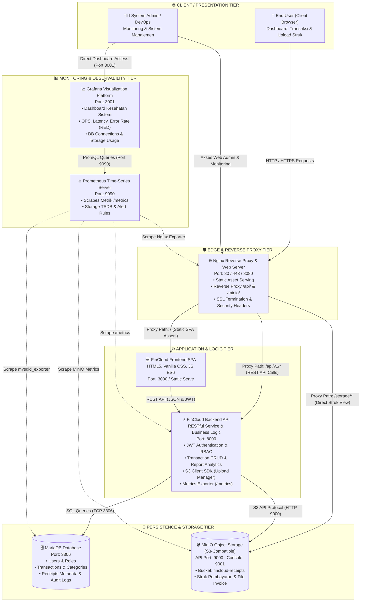

# Cloud9 - Cloud-Based Financial Management & Monitoring Platform
> **Developed by Team Cloud9**

[](file:///c:/Users/Feeandri/cloud9-fincloudApp/frontend)
[](file:///c:/Users/Feeandri/cloud9-fincloudApp/database)
[](file:///c:/Users/Feeandri/cloud9-fincloudApp/Cloud9)
[](file:///c:/Users/Feeandri/cloud9-fincloudApp/infra/nginx)
[](file:///c:/Users/Feeandri/cloud9-fincloudApp/infra)
[](file:///c:/Users/Feeandri/cloud9-fincloudApp/infra)

---

## 📌 Tentang Cloud9

**FinCloud** adalah platform manajemen dan pemantauan keuangan pribadi serta tim yang dirancang dengan arsitektur *cloud-native*. FinCloud memberikan visibilitas menyeluruh terhadap arus kas (*cash flow*), pencatatan transaksi masuk dan keluar, penyimpanan digital bukti transaksi (struk pembayaran/faktur) ke object storage berbasis S3, laporan analitik keuangan interaktif, serta kesiapan integrasi monitoring kesehatan infrastruktur cloud secara *real-time*.

Platform ini mengusung pendekatan antarmuka modern yang ringan dan responsif tanpa ketergantungan library eksternal yang berat, didukung oleh skema basis data relasional MariaDB dan orkestrasi kontainer Docker.

---

## ✨ Fitur Utama

### 1. 🔐 Autentikasi Pengguna & Akses Berbasis Peran (RBAC)
- **Split-Screen Glassmorphism UI**: Tampilan login dan registrasi interaktif dilengkapi ringkasan visual platform keuangan cloud.
- **Validasi Formulir Cerdas**: Pengecekan format email, indikator kekuatan kata sandi (*password strength meter*), dan konfirmasi password.
- **1-Klik Demo Quick Login**: Akses instan untuk pengujian tanpa perlu mengisi form:
  - 👤 **Login sebagai User** (`Feeandri` - Role: `USER`)
  - 🛡️ **Login sebagai Admin** (Administrator Sistem - Role: `ADMIN`)
- **Penyimpanan Sesi Aman**: Menggunakan `localStorage` dengan proteksi rute otomatis (*auth guard*).

### 2. 📊 Dashboard Finansial Dinamis (`#/dashboard`)
- **Kartu Metrik KPI Real-Time**:
  - Saldo Bersih (*Net Balance*)
  - Total Pemasukan (*Income*)
  - Total Pengeluaran (*Expense*)
  - Rasio Tabungan (*Savings Rate %*)
- **Grafik Tren Arus Kas**: Grafik batang canvas interaktif (*Cash Flow Bar Chart*) yang membandingkan pemasukan dan pengeluaran.
- **Distribusi Kategori Belanja**: Grafik donat canvas (*Donut Chart*) untuk memetakan alokasi biaya (makanan, hunian, utilitas, investasi, dsb).
- **Aktivitas Transaksi Terkini**: Ringkasan transaksi terbaru lengkap dengan badge jenis transaksi dan thumbnail bukti struk.
- **Widget Health Check Cloud**: Indikator status koneksi node database MariaDB, MinIO S3, dan Prometheus.

### 3. 💸 Manajemen Transaksi & Bukti Pembayaran (`#/transactions`)
- **Operasi CRUD Penuh**: Tambah transaksi baru, perbarui data nominal/kategori/catatan, dan hapus transaksi dengan modal konfirmasi aman.
- **Pencarian & Multi-Filter Instan**:
  - Filter Tipe: *Semua*, *Pemasukan*, *Pengeluaran*.
  - Filter Kategori: Kategori standar sesuai ERD database.
  - Filter Periode: *Bulan Ini*, *Bulan Lalu*, *Semua*.
  - Pencarian teks instan berdasarkan deskripsi catatan.
- **Simulasi Object Storage MinIO S3**:
  - Area drag & drop unggah file struk/faktur (format gambar & PDF).
  - Preview thumbnail instan sebelum transaksi disimpan.
  - **Modal Penampil Struk (Receipt Viewer)** dengan resolusi penuh dan opsi download berkas.
- **Paginasi Data**: Navigasi tabel transaksi yang rapi dan terstruktur.

### 4. 📈 Laporan Keuangan Komprehensif (`#/reports`)
- **Executive Summary**: Rata-rata pengeluaran harian, rasio tabungan, dan surplus bersih periode terpilih.
- **Pilihan Periode Fleksibel**: *Bulan Ini*, *Kuartal 4*, *Tahun Berjalan*, atau *Semua Waktu*.
- **Peringkat Pengeluaran per Kategori**: Visualisasi progress bar persentase beban biaya terbesar.
- **Tabel Rekapitulasi**: Detail frekuensi transaksi, total nominal, dan alokasi persentase per kategori.
- **Ekspor & Cetak Siap Pakai**:
  - 📥 **Ekspor CSV**: Unduh riwayat transaksi ke format `.csv` yang kompatibel dengan Microsoft Excel dan Google Sheets.
  - 🖨️ **Cetak Laporan / Simpan PDF**: Stylesheet khusus cetak (`@media print`) yang menyembunyikan sidebar dan tombol kontrol untuk dokumen resmi siap cetak.

### 5. 🌓 Personalisasi Tema
- Penggantian instan antara **Dark Mode** dan **Light Mode** dengan penyimpanan preferensi pengguna.

---

## 🏛️ Arsitektur Sistem

FinCloud mengadopsi pola arsitektur *layered cloud-native* dengan pemisahan tanggung jawab yang jelas:



### Tabel Komponen & Alokasi Port

| Komponen | Layer / Tier | Port Standar | Fungsi & Tanggung Jawab |
|---|---|---|---|
| **Frontend SPA** | Client / Web App | `3000` | Antarmuka Single Page Application (HTML5, CSS Variables, JS ES6). |
| **Nginx** | Edge Ingress Proxy | `80` / `8080` | Reverse proxy utama, load distribution, dan static asset server. |
| **Backend API** | Application Logic | `8000` | REST API service, JWT RBAC auth, agregasi laporan keuangan, S3 client. |
| **MariaDB** | Relational Database | `3306` | Penyimpanan entitas relasional (Users, Transactions, Audit Logs). |
| **MinIO** | Object Storage (S3) | `9000` / `9001` | Penyimpanan berkas struk bukti pembayaran (*receipts bucket*). |
| **Prometheus** | Monitoring TSDB | `9090` | Perekam metrik time-series & scraping sistem secara berkala. |
| **Grafana** | Visualisasi Metrik | `3001` | Dashboard analitik kesehatan infrastruktur dan utilisasi cloud. |

---

## 📁 Struktur Direktori Repositori

```text
cloud9-fincloudApp/
├── backend/                  # Spesifikasi REST API & ringkasan endpoint
├── Cloud9/                   # Konfigurasi lab Docker Compose (Nginx & MariaDB)
│   ├── docker-compose.yml    # Service definition Nginx & MariaDB container
│   └── index.html            # Landing status service Nginx
├── database/                 # Skema DDL & seed data MariaDB
│   ├── schema.sql            # Definisi tabel (roles, users, categories, transactions, dll)
│   └── seed.sql              # Inisialisasi awal roles dan kategori transaksi
├── docs/                     # Dokumentasi arsitektur dan perencanaan proyek
│   ├── 01-charter.md         # Project charter (tujuan, scope, deliverables)
│   ├── 04-branching-rules.md # Panduan workflow Git tim
│   ├── 05-erd-draft.md       # Spesifikasi Entity Relationship Diagram (ERD)
│   ├── 13-use-case.md        # Spesifikasi alur use case sistem
│   ├── DOKUMENTASI_LENGKAP.md# Dokumentasi lengkap proyek FinCloud
│   └── diagrams/             # Diagram arsitektur (.mmd & .md) dan ERD
├── frontend/                 # Aplikasi Single Page Application FinCloud
│   ├── index.html            # Entry point SPA (routing container, modals, layouts)
│   ├── package.json          # Script otomasi serve lokal
│   ├── README.md             # Dokumentasi modul frontend
│   ├── css/                  # Arsitektur CSS modular
│   │   ├── variables.css     # Tokens warna fintech, dark/light theme, typography
│   │   ├── base.css          # Layout responsif (sidebar, header, mobile navbar)
│   │   ├── components.css    # Komponen reusable (cards, badges, modals, toasts)
│   │   ├── auth.css          # Desain split-view hero login & register
│   │   ├── dashboard.css     # Grid KPI, canvas charts, widget transaksi
│   │   ├── transactions.css  # Toolbar filter, tabel, dropzone upload struk
│   │   └── reports.css       # Summary cards, ranking progress bar, print layout
│   └── js/                   # Logika JavaScript ES6 modular
│       ├── store.js          # Reactive state store, seed data, persistence localStorage
│       ├── router.js         # Client-side hash router (#/login, #/dashboard, dll)
│       ├── auth.js           # Penanganan autentikasi & demo quick login
│       ├── dashboard.js      # Rendering chart canvas (Bar Chart & Donut Chart)
│       ├── transactions.js   # Operasi CRUD transaksi, pencarian, dan filtering
│       ├── reports.js        # Kalkulasi analitik laporan & generator CSV
│       └── app.js            # Initializer aplikasi, modal controller, switch theme
├── infra/                    # Konfigurasi infrastruktur (Prometheus, Grafana, Loki, Nginx)
├── scripts/                  # Script helper deployment & otomasi
├── tests/                    # Pengujian unit & integrasi
├── .env.example              # Template variabel lingkungan
└── README.md                 # Dokumentasi utama proyek
```

---

## 🗄️ Model Basis Data (MariaDB)

Skema basis data relasional diinisialisasi melalui [`database/schema.sql`](file:///c:/Users/Feeandri/cloud9-fincloudApp/database/schema.sql) dan [`database/seed.sql`](file:///c:/Users/Feeandri/cloud9-fincloudApp/database/seed.sql):

| Nama Tabel | Fungsi Utama | Kunci Asing (Foreign Keys) |
|---|---|---|
| `roles` | Hak akses pengguna (`ADMIN`, `USER`) | - |
| `users` | Akun pengguna terdaftar dan hash kata sandi | `role_id` -> `roles(id)` |
| `categories` | Master kategori transaksi (Pemasukan & Pengeluaran) | - |
| `transactions` | Catatan transaksi keuangan, nominal, tanggal, tipe | `user_id` -> `users(id)`, `category_id` -> `categories(id)` |
| `receipts` | Metadata berkas lampiran struk di Object Storage | `transaction_id` -> `transactions(id)` |
| `audit_logs` | Catatan riwayat aktivitas pengguna untuk audit trail | `user_id` -> `users(id)` |

---

## 🚀 Panduan Menjalankan Sistem

### 1. Menjalankan Frontend Web (Rekomendasi)

Aplikasi frontend berjalan langsung menggunakan Node static server:

```powershell
# Masuk ke folder frontend
cd frontend

# Jalankan server
npm start
```
> Atau menggunakan npx: `npx serve . -l 3000`

Akses di browser:
- **Lokal**: [http://localhost:3000](http://localhost:3000)
- **Perangkat Lain (Wi-Fi LAN yang sama)**: `http://<IP-Komputer-Anda>:3000` (contoh: `http://192.168.32.157:3000`)
- **Akses Publik / Demo Mobile via Tunneling**:
  ```powershell
  npx localtunnel --port 3000
  ```

### 2. Menjalankan Lingkungan Lab Docker (Nginx & MariaDB)

Untuk menjalankan layanan backend lab dan basis data relasional:

```powershell
# Masuk ke direktori Cloud9
cd Cloud9

# Jalankan container
docker compose up -d
```

- **Nginx Web Endpoint**: [http://localhost:8080](http://localhost:8080)
- **MariaDB Database**: Port `3306` (Database: `webdb`, User: `webuser`)
- **Menghentikan Container**: `docker compose down`

---

## 🔑 Akun Demo (Quick Login)

Anda dapat langsung menguji aplikasi dengan mengklik tombol **Demo Login** di halaman masuk (`#/login`) atau menggunakan kredensial:

| Peran (Role) | Email | Kata Sandi | Akses |
|---|---|---|---|
| **USER** | `feeandri@fincloud.local` | `Feeandri123!` | Manajemen transaksi pribadi, dashboard arus kas, upload struk, ekspor laporan. |
| **ADMIN** | `admin@fincloud.local` | `Admin123!` | Seluruh fitur USER + visibilitas status infrastruktur cloud dan konfigurasi. |

---

## 🌿 Kebijakan Git Branching

Mengikuti panduan [`docs/04-branching-rules.md`](file:///c:/Users/Feeandri/cloud9-fincloudApp/docs/04-branching-rules.md):

- **Branch Utama**:
  - `main`: Kode stabil siap rilis/produksi.
  - `develop`: Pusat integrasi seluruh fitur yang telah selesai diuji.
- **Branch Pengembang**:
  - Format penamaan fitur: `feature/<nama-fitur>` atau branch developer seperti `FeeandriDev`, `ArbyDev`, `JepsDev`.
- **Workflow**:
  1. Selalu lakukan `git pull origin develop` sebelum membuat perubahan.
  2. Lakukan pengujian mandiri sebelum membuat Pull Request ke `develop`.
  3. Selesaikan konflik merge secara kolaboratif.

---

## 📚 Tautan Dokumentasi Terkait

- 📖 [Dokumentasi Lengkap Proyek (docs/DOKUMENTASI_LENGKAP.md)](file:///c:/Users/Feeandri/cloud9-fincloudApp/docs/DOKUMENTASI_LENGKAP.md)
- 📐 [Spesifikasi Arsitektur Sistem (docs/diagrams/06-arsitektur-sistem.md)](file:///c:/Users/Feeandri/cloud9-fincloudApp/docs/diagrams/06-arsitektur-sistem.md)
- 📊 [Spesifikasi Diagram ERD (docs/05-erd-draft.md)](file:///c:/Users/Feeandri/cloud9-fincloudApp/docs/05-erd-draft.md)
- 📋 [Spesifikasi Use Case (docs/13-use-case.md)](file:///c:/Users/Feeandri/cloud9-fincloudApp/docs/13-use-case.md)
- 💻 [Dokumentasi Antarmuka Frontend (frontend/README.md)](file:///c:/Users/Feeandri/cloud9-fincloudApp/frontend/README.md)

---

&copy; 2026 **Team Cloud9** — FinCloud Platform. All rights reserved.
