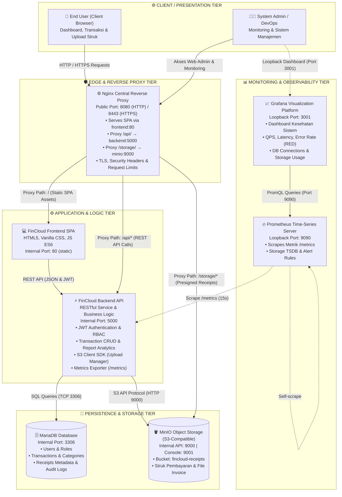

# Cloud9 - Cloud-Based Financial Management & Monitoring Platform
> **Developed by Team Cloud9**

[](file:///c:/Users/Feeandri/cloud9-fincloudApp/frontend)
[](file:///c:/Users/Feeandri/cloud9-fincloudApp/database)
[](file:///c:/Users/Feeandri/cloud9-fincloudApp/Cloud9)
[](file:///c:/Users/Feeandri/cloud9-fincloudApp/infra/nginx)
[](file:///c:/Users/Feeandri/cloud9-fincloudApp/infra)
[](file:///c:/Users/Feeandri/cloud9-fincloudApp/infra)

---

## 📌 Tentang Cloud9

**FinCloud** adalah platform manajemen dan pemantauan keuangan pribadi serta tim yang dirancang dengan arsitektur *cloud-native*. FinCloud memberikan visibilitas menyeluruh terhadap arus kas (*cash flow*), pencatatan transaksi masuk dan keluar, penyimpanan digital bukti transaksi (struk pembayaran/faktur) ke object storage berbasis S3, laporan analitik keuangan interaktif, serta kesiapan integrasi monitoring kesehatan infrastruktur cloud secara *real-time*.

Platform ini mengusung pendekatan antarmuka modern yang ringan dan responsif tanpa ketergantungan library eksternal yang berat, didukung oleh skema basis data relasional MariaDB dan orkestrasi kontainer Docker.

---

## 👥 Tim Pengembang (Team Cloud9)

Berikut adalah pembagian peran dan branch kerja masing-masing anggota tim pengembang:

| No | Nama | Branch | Peran |
|:--:|---|---|---|
| 1 | **Muhammad Feeandri Syahbani** | `FeeandriDev` | Database Engineer & Cloud Security Engineer |
| 2 | **Arby Putra** | `ArbyDev` | Storage & Reliability Engineer |
| 3 | **Muhammad Farrel Gustiawan** | `BojongDev` | Backend/API Developer |
| 4 | **Yasmin Akmaliyah** | `YasminDev` | QA, Integration & Documentation Engineer |
| 5 | **Farelly DeRossi** | `BejekDev` | Frontend Lead |
| 6 | **Agustina Elsi Bunga** | `IraDev` | Cloud Infrastructure Engineer |
| 7 | **Kenjiro Boantua H.G** | `KenjiroDev` | DevOps & Container Engineer |
| 8 | **Ihsanul Farrel** | `ElloDev` | Monitoring & Logging Engineer |

---

## ✨ Fitur Utama

### 1. 🔐 Autentikasi Pengguna & Akses Berbasis Peran (RBAC)
- **Split-Screen Glassmorphism UI**: Tampilan login dan registrasi interaktif dilengkapi ringkasan visual platform keuangan cloud.
- **Validasi Formulir Cerdas**: Pengecekan format email, indikator kekuatan kata sandi (*password strength meter*), dan konfirmasi password.
- **1-Klik Demo Quick Login**: Akses instan untuk pengujian tanpa perlu mengisi form:
  - 👤 **Login sebagai User** (`Feeandri` - Role: `USER`)
  - 🛡️ **Login sebagai Admin** (Administrator Sistem - Role: `ADMIN`)
- **Penyimpanan Sesi Aman**: JWT disimpan di `localStorage`, divalidasi masa berlakunya (`exp`), dan dilengkapi proteksi rute otomatis (*auth guard*).

### 2. 📊 Dashboard Finansial Dinamis (`#/dashboard`)
- **Kartu Metrik KPI Real-Time**:
  - Saldo Bersih (*Net Balance*)
  - Total Pemasukan (*Income*)
  - Total Pengeluaran (*Expense*)
  - Rasio Tabungan (*Savings Rate %*)
- **Grafik Tren Arus Kas**: Grafik batang canvas interaktif (*Cash Flow Bar Chart*) yang membandingkan pemasukan dan pengeluaran.
- **Distribusi Kategori Belanja**: Grafik donat canvas (*Donut Chart*) untuk memetakan alokasi biaya (makanan, hunian, utilitas, investasi, dsb).
- **Aktivitas Transaksi Terkini**: Ringkasan transaksi terbaru lengkap dengan badge jenis transaksi dan thumbnail bukti struk.
- **Widget Health Check Cloud**: Indikator status koneksi node database MariaDB, MinIO S3, dan Prometheus.

### 3. 💸 Manajemen Transaksi & Bukti Pembayaran (`#/transactions`)
- **Operasi CRUD Penuh**: Tambah transaksi baru, perbarui data nominal/kategori/catatan, dan hapus transaksi dengan modal konfirmasi aman.
- **Pencarian & Multi-Filter Instan**:
  - Filter Tipe: *Semua*, *Pemasukan*, *Pengeluaran*.
  - Filter Kategori: Kategori standar sesuai ERD database.
  - Filter Periode: *Bulan Ini*, *Bulan Lalu*, *Semua*.
  - Pencarian teks instan berdasarkan deskripsi catatan.
- **Upload Object Storage MinIO S3 (Nyata)**:
  - Area drag & drop unggah file struk/faktur (format gambar & PDF).
  - Upload multipart ke bucket privat `fincloud-receipts` melalui **AWS S3 SDK**.
  - Preview thumbnail instan sebelum transaksi disimpan.
  - **Modal Penampil Struk (Receipt Viewer)** dengan resolusi penuh dan opsi download berkas melalui **presigned URL** berumur terbatas (default 1 jam).
- **Paginasi Data**: Navigasi tabel transaksi yang rapi dan terstruktur.

### 4. 📈 Laporan Keuangan Komprehensif (`#/reports`)
- **Executive Summary**: Rata-rata pengeluaran harian, rasio tabungan, dan surplus bersih periode terpilih.
- **Pilihan Periode Fleksibel**: *Bulan Ini*, *Kuartal 4*, *Tahun Berjalan*, atau *Semua Waktu*.
- **Peringkat Pengeluaran per Kategori**: Visualisasi progress bar persentase beban biaya terbesar.
- **Tabel Rekapitulasi**: Detail frekuensi transaksi, total nominal, dan alokasi persentase per kategori.
- **Ekspor & Cetak Siap Pakai**:
  - 📥 **Ekspor CSV**: Unduh riwayat transaksi ke format `.csv` yang kompatibel dengan Microsoft Excel dan Google Sheets.
  - 🖨️ **Cetak Laporan / Simpan PDF**: Stylesheet khusus cetak (`@media print`) yang menyembunyikan sidebar dan tombol kontrol untuk dokumen resmi siap cetak.

### 5. 🌓 Personalisasi Tema
- Penggantian instan antara **Dark Mode** dan **Light Mode** dengan penyimpanan preferensi pengguna.

---

## 🏛️ Arsitektur Sistem

FinCloud mengadopsi pola arsitektur *layered cloud-native* dengan pemisahan tanggung jawab yang jelas:



### Tabel Komponen & Alokasi Port

| Komponen | Layer / Tier | Port Standar | Fungsi & Tanggung Jawab |
|---|---|---|---|
| **Frontend SPA** | Client / Web App | `3000` (local dev) / internal `80` | Antarmuka Single Page Application (HTML5, CSS Variables, JS ES6). |
| **Nginx** | Edge Ingress Proxy | **`8080`** (HTTP) / **`8443`** (HTTPS, public) | Satu-satunya pintu masuk publik: `/` → frontend, `/api/` → backend, `/storage/` → MinIO, TLS, security headers. |
| **Backend API** | Application Logic | internal `5000` (loopback `127.0.0.1:5000`) | REST API service, JWT RBAC auth, agregasi laporan keuangan, S3 client. |
| **MariaDB** | Relational Database | loopback `127.0.0.1:3306` | Penyimpanan entitas relasional (Users, Transactions, Audit Logs). |
| **MinIO** | Object Storage (S3) | loopback `127.0.0.1:9000` / `9001` | Penyimpanan berkas struk bukti pembayaran (*receipts bucket*). |
| **Prometheus** | Monitoring TSDB | loopback `127.0.0.1:9090` | Perekam metrik time-series & scraping sistem secara berkala. |
| **Grafana** | Visualisasi Metrik | loopback `127.0.0.1:3001` | Dashboard analitik kesehatan infrastruktur dan utilisasi cloud. |

---

## 📁 Struktur Direktori Repositori

```text
cloud9-fincloudApp/
├── backend/                  # REST API Express (src/, unit test, .env.example)
├── Cloud9/                   # Konfigurasi lab Docker Compose (Nginx & MariaDB)
│   ├── docker-compose.yml    # Service definition Nginx & MariaDB container
│   └── index.html            # Landing status service Nginx
├── database/                 # Skema DDL & seed data MariaDB
│   ├── schema.sql            # Definisi tabel (roles, users, categories, transactions, dll)
│   └── seed.sql              # Inisialisasi awal roles dan kategori transaksi
├── docs/                     # Dokumentasi arsitektur dan perencanaan proyek
│   ├── 01-charter.md         # Project charter (tujuan, scope, deliverables)
│   ├── 04-branching-rules.md # Panduan workflow Git tim
│   ├── 05-erd-draft.md       # Spesifikasi Entity Relationship Diagram (ERD)
│   ├── 13-use-case.md        # Spesifikasi alur use case sistem
│   ├── 21-notulen-minggu2.md # Notulen rapat minggu 2
│   ├── 22-test-checklist-qa-report.md # Laporan QA & checklist pengujian
│   ├── 23-sop-backup-recovery.md      # SOP backup, restore & disaster recovery
│   ├── 24-backup-drill-report.md      # Laporan DR drill backup & restore
│   ├── DOKUMENTASI_LENGKAP.md         # Dokumentasi lengkap proyek FinCloud
│   └── diagrams/             # Diagram arsitektur (.mmd & .md) dan ERD
├── frontend/                 # Aplikasi Single Page Application FinCloud
│   ├── index.html            # Entry point SPA (routing container, modals, layouts)
│   ├── package.json          # Script otomasi serve lokal
│   ├── README.md             # Dokumentasi modul frontend
│   ├── css/                  # Arsitektur CSS modular
│   │   ├── variables.css     # Tokens warna fintech, dark/light theme, typography
│   │   ├── base.css          # Layout responsif (sidebar, header, mobile navbar)
│   │   ├── components.css    # Komponen reusable (cards, badges, modals, toasts)
│   │   ├── auth.css          # Desain split-view hero login & register
│   │   ├── dashboard.css     # Grid KPI, canvas charts, widget transaksi
│   │   ├── transactions.css  # Toolbar filter, tabel, dropzone upload struk
│   │   └── reports.css       # Summary cards, ranking progress bar, print layout
│   ├── js/                   # Logika JavaScript ES6 modular
│   │   ├── config.js         # API base URL & storage keys (local dev / Docker)
│   │   ├── api.js            # HTTP client, JWT header, timeout & error handling
│   │   ├── store.js          # API-backed state store & in-memory cache
│   │   ├── router.js         # Client-side hash router (#/login, #/dashboard, dll)
│   │   ├── auth.js           # Penanganan autentikasi & demo quick login
│   │   ├── dashboard.js      # Rendering chart canvas (Bar Chart & Donut Chart)
│   │   ├── transactions.js   # Operasi CRUD transaksi, pencarian, dan filtering
│   │   ├── reports.js        # Kalkulasi analitik laporan & generator CSV
│   │   ├── finance.js        # Kalkulasi finansial murni (cashflow, kategori, rasio)
│   │   └── app.js            # Initializer aplikasi, modal controller, switch theme
│   └── tests/                # Unit test frontend (node --test, 14 tes)
├── infra/                    # Konfigurasi infrastruktur
│   ├── nginx/nginx.conf      # Reverse proxy HTTP (:8080) + HTTPS (:8443)
│   ├── nginx/fincloud-locations.conf # Routing bersama untuk kedua server
│   ├── nginx/certs/          # Sertifikat TLS (gitignored, generated otomatis)
│   ├── prometheus/           # prometheus.yml + alert.rules.yml (10 alert)
│   ├── grafana/              # Provisioning datasource + 3 dashboard FinCloud
│   ├── loki/                 # Konfigurasi Loki & Promtail (log terpusat)
│   └── node-exporter/        # Konfigurasi metrik host
├── scripts/                  # Otomasi backup/restore + penjadwalan (lihat scripts/README.md)
├── tests/                    # End-to-end test (Node.js, 78 check)
├── backups/                  # Output backup (gitignored; tidak di-commit)
├── .env.example              # Template variabel lingkungan (copy ke .env)
├── docker-compose.yml        # Definisi seluruh service stack
└── README.md                 # Dokumentasi utama proyek
```

---

## 🗄️ Model Basis Data (MariaDB)

Skema basis data relasional diinisialisasi melalui [`database/schema.sql`](file:///c:/Users/Feeandri/cloud9-fincloudApp/database/schema.sql) dan [`database/seed.sql`](file:///c:/Users/Feeandri/cloud9-fincloudApp/database/seed.sql):

| Nama Tabel | Fungsi Utama | Kunci Asing (Foreign Keys) |
|---|---|---|
| `roles` | Hak akses pengguna (`ADMIN`, `USER`) | - |
| `users` | Akun pengguna terdaftar dan hash kata sandi | `role_id` -> `roles(id)` |
| `categories` | Master kategori transaksi (Pemasukan & Pengeluaran) | - |
| `transactions` | Catatan transaksi keuangan, nominal, tanggal, tipe | `user_id` -> `users(id)`, `category_id` -> `categories(id)` |
| `receipts` | Metadata berkas lampiran struk di Object Storage | `transaction_id` -> `transactions(id)` |
| `audit_logs` | Catatan riwayat aktivitas pengguna untuk audit trail | `user_id` -> `users(id)` |

---

## 🔌 Ringkasan Endpoint REST API

Base URL: `/api` saat diakses lewat Nginx, atau `http://localhost:5000/api` pada
local dev. Endpoint bertanda 🔒 memerlukan header `Authorization: Bearer <JWT>`.

### Autentikasi

| Method | Endpoint | Akses | Fungsi |
|---|---|---|---|
| `POST` | `/api/auth/register` | Publik | Registrasi akun baru (role `USER`) |
| `POST` | `/api/auth/login` | Publik | Login dan penerbitan JWT |
| `POST` | `/api/auth/logout` | 🔒 | Catat logout ke audit trail |
| `GET` | `/api/auth/profile` | 🔒 | Ambil profil pengguna aktif |
| `PUT` | `/api/auth/profile` | 🔒 | Perbarui nama/email/password |

> Route autentikasi juga tersedia sebagai alias tanpa prefix `/auth`:
> `/api/register`, `/api/login`, `/api/logout`, dan `/api/profile`.

### Transaksi & Struk

| Method | Endpoint | Akses | Fungsi |
|---|---|---|---|
| `GET` | `/api/transactions/categories` | 🔒 | Daftar kategori pemasukan/pengeluaran |
| `GET` | `/api/transactions` | 🔒 | Daftar transaksi (pagination, filter tipe/kategori/periode, pencarian) |
| `GET` | `/api/transactions/:id` | 🔒 | Detail transaksi milik pengguna |
| `POST` | `/api/transactions` | 🔒 | Buat transaksi baru |
| `PUT` | `/api/transactions/:id` | 🔒 | Ubah transaksi (partial update) |
| `DELETE` | `/api/transactions/:id` | 🔒 | Hapus transaksi beserta struk |
| `GET` | `/api/transactions/:id/receipt-url` | 🔒 | Presigned URL struk (TTL terbatas) |
| `POST` | `/api/transactions/:id/receipt` | 🔒 | Upload struk (`multipart/form-data`, maks. 10 MB) |
| `DELETE` | `/api/transactions/:id/receipt` | 🔒 | Hapus struk dari MinIO & metadata |

### Dashboard & Laporan

| Method | Endpoint | Akses | Fungsi |
|---|---|---|---|
| `GET` | `/api/dashboard` | 🔒 | Agregasi KPI dashboard pengguna |
| `GET` | `/api/reports/monthly` | 🔒 | Rekap arus kas bulanan |
| `GET` | `/api/reports/category` | 🔒 | Rekap pengeluaran per kategori |

### Admin (role `ADMIN`)

| Method | Endpoint | Fungsi |
|---|---|---|
| `GET` | `/api/admin/users` | Daftar pengguna terdaftar |
| `GET` | `/api/admin/audit-logs` | Riwayat audit aktivitas |
| `GET` | `/api/admin/system-status` | Status database, storage, dan sistem |

### Health & Metrics

| Method | Endpoint | Akses | Fungsi |
|---|---|---|---|
| `GET` | `/api/health` | Publik | Status API, MariaDB, dan MinIO |
| `GET` | `/metrics` | Internal (Docker network / loopback) | Metrik Prometheus |

---

## 🚀 Panduan Menjalankan Sistem

### 1. Menjalankan Frontend + Backend (Local Dev, Tanpa Docker)

Frontend dan backend dijalankan terpisah. Mulai backend terlebih dahulu:

```powershell
cd backend
npm install
npm run dev
# API tersedia di http://localhost:5000/api
```

Lalu jalankan frontend static server:

```powershell
cd frontend
npm start
```
> Atau menggunakan npx: `npx serve . -l 3000`

Pastikan MariaDB aktif di `127.0.0.1:3306` dan MinIO di `127.0.0.1:9000`
(atau sesuaikan `backend/.env`). Untuk MinIO lokal, bucket `fincloud-receipts`
dibuat otomatis saat backend start.

Akses di browser:
- **Lokal**: [http://localhost:3000](http://localhost:3000)
- **Perangkat Lain (Wi-Fi LAN yang sama)**: `http://<IP-Komputer-Anda>:3000` (contoh: `http://192.168.32.157:3000`)
- **Akses Publik / Demo Mobile via Tunneling**:
  ```powershell
  npx localtunnel --port 3000
  ```

### 2. Menjalankan Seluruh Stack dengan Docker Compose

**Prasyarat: siapkan `.env` (wajib).** Semua kredensial dibaca dari file ini;
tidak ada password yang di-hardcode di `docker-compose.yml`.

```powershell
Copy-Item .env.example .env
notepad .env   # isi MARIADB_ROOT_PASSWORD, DB_PASSWORD, JWT_SECRET, MinIO, Grafana
```

Gunakan secret acak, misalnya `openssl rand -hex 32`. File `.env` sudah
di-gitignore dan **tidak boleh di-commit**.

Cara paling mudah untuk menjalankan FinCloud (MariaDB + Backend API + MinIO +
Frontend + Nginx edge + Prometheus + Grafana) adalah dari root repositori:

```powershell
# Build & jalankan semua service
docker compose up -d --build

# Lihat status container
docker compose ps

# Validasi konfigurasi & variabel .env
docker compose config --quiet

# Menghentikan container
docker compose down

# Reset total (termasuk volume database & MinIO)
docker compose down -v
```

**Satu pintu masuk publik:** hanya service `nginx` yang dipublikasikan ke
seluruh antarmuka (`8080` HTTP dan `8443` HTTPS). Service lain di-bind ke
loopback atau hanya tersedia di jaringan Docker internal.

| Layanan | URL / Port | Keterangan |
|---|---|---|
| **Aplikasi (Frontend, HTTPS)** | [https://localhost:8443](https://localhost:8443) | Nginx edge → `frontend:80` (SPA); sertifikat self-signed |
| **Aplikasi (Frontend, HTTP)** | [http://localhost:8080](http://localhost:8080) | Tetap tersedia untuk kompatibilitas & tooling lokal |
| **REST API (HTTPS)** | [https://localhost:8443/api](https://localhost:8443/api) | Nginx edge → `backend:5000` |
| **REST API (HTTP)** | [http://localhost:8080/api](http://localhost:8080/api) | Nginx edge → `backend:5000` |
| **Struk (storage)** | `https://localhost:8443/storage/...` | HTTPS/HTTP mengikuti origin halaman; hanya presigned URL yang valid |
| **Backend (debug)** | `http://127.0.0.1:5000/api` | Loopback only; tidak terbuka ke LAN |
| **MinIO API** | `http://127.0.0.1:9000` | Loopback only; bucket privat `fincloud-receipts` |
| **MinIO Console** | [http://localhost:9001](http://localhost:9001) | Loopback only; login sesuai `MINIO_ROOT_USER` / `MINIO_ROOT_PASSWORD` |
| **MariaDB** | `127.0.0.1:3306` | Loopback only; database `fincloud_db`, user `DB_USER` |
| **Prometheus** | [http://localhost:9090](http://localhost:9090) | Loopback only; scrape backend, host, dan container tiap 15 detik |
| **Node Exporter** | [http://localhost:9100](http://localhost:9100) | Loopback only; metrik CPU, memory, disk, network host |
| **cAdvisor** | [http://localhost:8081](http://localhost:8081) | Loopback only; metrik CPU, memory, dan status container |
| **Loki** | [http://localhost:3100](http://localhost:3100) | Loopback only; agregasi log terpusat dari Promtail |
| **Grafana** | [http://localhost:3001](http://localhost:3001) | Loopback only; login `GRAFANA_ADMIN_USER` / `GRAFANA_ADMIN_PASSWORD` |

> Frontend Docker memakai URL relatif `/api`, sehingga tidak ada masalah CORS.
> Struk diambil melalui **presigned URL** dengan path prefix `/storage`. Nginx
> menghapus prefix tersebut sebelum meneruskan request ke MinIO sehingga
> signature SigV4 tetap valid. Backend menandatangani URL mengikuti origin
> request (`X-Forwarded-Proto` + `X-Forwarded-Host`), jadi halaman HTTP memakai
> URL HTTP dan halaman HTTPS memakai URL HTTPS tanpa konfigurasi tambahan.
> `MINIO_PUBLIC_ENDPOINT` + `MINIO_PUBLIC_PORT` + `MINIO_PUBLIC_USE_SSL` hanya
> menjadi fallback saat backend diakses langsung tanpa reverse proxy. Untuk
> deployment remote, set `MINIO_PUBLIC_ENDPOINT` ke domain/IP server.
>
> Untuk local dev tanpa Docker, jalankan backend di port `5000` lalu frontend
> di port `3000`; `frontend/js/config.js` otomatis mengarah ke
> `http://localhost:5000/api` dan struk diambil langsung dari MinIO
> (`MINIO_PUBLIC_PATH_PREFIX` kosong).

### 2.1 Sertifikat HTTPS (Self-Signed untuk Demo)

Service `certs` membuat sertifikat self-signed pada `docker compose up` pertama
jika `infra/nginx/certs/fincloud.crt` dan `fincloud.key` belum ada. Folder
tersebut **gitignored** dan tidak boleh di-commit. Sertifikat mencakup
`DNS:localhost` dan `IP:127.0.0.1`, berlaku 825 hari.

```powershell
# Cek sertifikat yang dibuat otomatis
Get-ChildItem infra\nginx\certs

# Regenerasi sertifikat (hapus lalu jalankan ulang certs + nginx)
Remove-Item infra\nginx\certs\fincloud.*
docker compose up -d certs nginx
```

Browser akan menampilkan peringatan sertifikat self-signed saat pertama kali
membuka `https://localhost:8443` — pilih *Advanced → Proceed* untuk demo lokal.
Sertifikat default hanya mencakup `localhost` dan `127.0.0.1`; untuk akses
lewat IP LAN/domain, ganti dengan sertifikat yang SAN-nya sesuai. Untuk
produksi, gunakan sertifikat dari CA terpercaya (mis. Let's Encrypt) tanpa
mengubah konfigurasi Nginx lainnya.

### 3. Reverse Proxy & Security Hardening

Konfigurasi edge ada di [`infra/nginx/nginx.conf`](file:///c:/Users/Feeandri/cloud9-fincloudApp/infra/nginx/nginx.conf)
dan di-mount sebagai `/etc/nginx/conf.d/default.conf`.

| Path publik | Diteruskan ke | Catatan |
|---|---|---|
| `/` | `frontend:80` | Static SPA + fallback `index.html` |
| `/api/` | `backend:5000` | REST API; `Host` asli dipertahankan |
| `/storage/` | `minio:9000` | Prefix `/storage` dihapus; `Host` dipertahankan agar signature valid |
| `/minio/` | — | Diblokir `404` (console tidak diekspos) |
| `/nginx-health` | — | Liveness probe container |

Routing di atas berlaku identik pada server HTTP (`:80`) dan HTTPS (`:443`)
melalui include `infra/nginx/fincloud-locations.conf`.

Langkah hardening yang diterapkan:

- **TLS/HTTPS** — Nginx melayani HTTP dan HTTPS; TLS 1.2/1.3, HSTS pada
  response HTTPS, dan sertifikat dapat diganti tanpa mengubah config.
- **Secret terpusat** — seluruh password/JWT/MinIO/Grafana dibaca dari `.env`
  melalui interpolasi `${VAR:?pesan}`; Compose menolak start bila variabel
  wajib belum diisi.
- **Minimal exposure** — hanya port `8080` (HTTP) dan `8443` (HTTPS) yang
  terbuka ke jaringan. Backend, MariaDB, MinIO, Prometheus, Node Exporter,
  cAdvisor, Loki, dan Grafana di-bind ke `127.0.0.1`.
- **Security headers** — `X-Frame-Options`, `X-Content-Type-Options`,
  `Referrer-Policy`, dan `X-XSS-Protection` ditambahkan di edge.
- **CORS allowlist** — backend hanya mengirim header CORS untuk origin yang
  terdaftar di `CORS_ORIGINS`; request same-origin lewat Nginx tetap berjalan.
  Header `X-Powered-By` Express juga dimatikan.
- **Batasan upload** — `client_max_body_size 12m` (backend membatasi 10 MB).
- **Informasi minimal** — `server_tokens off` menyembunyikan versi Nginx.
- **Storage privat** — bucket MinIO tidak public-read; akses hanya lewat
  presigned URL ber-TTL (`MINIO_PRESIGN_EXPIRES`, default 3600 detik).
- **Console terlindungi** — MinIO console hanya loopback dan tidak diproxy.

Verifikasi cepat setelah stack berjalan:

```powershell
# Edge, API, dan health (HTTP)
Invoke-RestMethod http://localhost:8080/api/health

# Edge, API, dan health (HTTPS; curl -k untuk self-signed)
curl.exe -k https://localhost:8443/api/health

# Header keamanan + HSTS
curl.exe -k -I https://localhost:8443/

# Presigned receipt harus 200, akses anonymous harus 403
node tests/e2e/transactions.e2e.mjs
```

Saat mengganti secret di `.env`, jalankan ulang stack agar container memakai
nilai baru. Untuk MariaDB, password user yang sudah terlanjur dibuat di volume
lama tidak berubah otomatis — gunakan `ALTER USER` atau reset volume
(`docker compose down -v`) pada environment non-produksi.

---

## 📊 Monitoring & Observability (Prometheus + Grafana + Loki)

Stack observability berjalan otomatis bersama `docker compose up -d`:

1. **Backend** mengekspos `GET /metrics` (format Prometheus) memakai `prom-client`.
2. **Node Exporter** menyediakan metrik host: CPU, memory, disk, network.
3. **cAdvisor** menyediakan metrik per container: CPU, memory, filesystem, status.
4. **Prometheus** melakukan scrape 4 job (`fincloud-backend`, `prometheus`,
   `node-exporter`, `cadvisor`) setiap 15 detik dan menyimpan TSDB 15 hari.
5. **Promtail** membaca log seluruh container lewat Docker socket dan mengirimnya ke **Loki** (retensi 7 hari).
6. **Grafana** menyediakan tiga dashboard yang di-provision otomatis:
   - **FinCloud Overview** — RED metrics API, DB/storage health, transaksi, auth.
   - **FinCloud Infrastructure & Containers** — CPU/memory/disk host, network, metrik container.
   - **FinCloud Logs & Audit Trail** — log semua container, audit trail terstruktur, dan error.

```powershell
# Jalankan hanya stack observability
docker compose up -d --build backend node-exporter cadvisor prometheus loki promtail grafana

# Cek target scrape: keempat job harus UP
# http://localhost:9090/targets

# Cek log masuk ke Loki
curl.exe "http://localhost:3100/loki/api/v1/label/service/values"

# Reload konfigurasi Prometheus tanpa restart container
docker compose exec prometheus wget -qO- --post-data='' http://localhost:9090/-/reload
```

> Audit event ditulis ke tabel `audit_logs` **dan** stdout terstruktur
> (`{"level":"audit",...}`), sehingga dapat dicari di dashboard
> **FinCloud Logs & Audit Trail** tanpa membuka database.

> `/metrics` sengaja berada di luar prefix `/api` sehingga **tidak** di-proxy
> oleh Nginx. Endpoint hanya dapat diakses dari jaringan Docker internal
> (dipakai Prometheus) atau dari host melalui `http://127.0.0.1:5000/metrics`
> karena port backend di-bind ke loopback.

### Metrik utama

| Metrik | Tipe | Label | Keterangan |
|---|---|---|---|
| `fincloud_http_requests_total` | Counter | `method`, `route`, `status` | Total request HTTP (RED metric) |
| `fincloud_http_request_duration_seconds` | Histogram | `method`, `route`, `status` | Latensi request |
| `fincloud_transactions_created_total` | Counter | `type` | Transaksi baru (`income`/`expense`) |
| `fincloud_receipt_uploads_total` | Counter | `result` | Upload struk (`success`/`invalid`/`error`) |
| `fincloud_receipt_upload_bytes_total` | Counter | — | Total byte struk yang diunggah |
| `fincloud_auth_attempts_total` | Counter | `result` | Login (`success`/`invalid_credentials`/`invalid_request`/`error`) |
| `fincloud_db_up` | Gauge | — | Konektivitas MariaDB (1/0) |
| `fincloud_storage_up` | Gauge | — | Konektivitas MinIO (1/0) |
| `fincloud_process_*`, `fincloud_nodejs_*` | Gauge/Counter | — | Metrik default Node.js (CPU, memory, event loop lag, GC) |
| `node_cpu_seconds_total`, `node_memory_*`, `node_filesystem_*`, `node_network_*` | Counter/Gauge | `instance`, `mode`, `mountpoint`, `device` | Metrik host dari Node Exporter |
| `container_cpu_usage_seconds_total`, `container_memory_working_set_bytes`, `container_last_seen` | Counter/Gauge | `service`, `name`, `image` | Metrik per container dari cAdvisor |

Label `route` memakai pola route Express (mis. `/api/transactions/:id`), bukan
ID asli, untuk mencegah ledakan cardinality.

> **Docker Desktop / Docker 29+ (containerd image store):** cAdvisor tidak bisa
> membaca metadata layer `overlay2` lama, sehingga Compose memberinya akses ke
> `/run/containerd` dan `/var/lib/containerd` dengan
> `--containerd-namespace=moby`. Socket Docker sengaja **tidak** di-mount:
> Docker factory yang gagal mengenali layer containerd akan menghapus container
> dari cache setelah resync (~5 menit), sehingga metrik per container hilang.
> Dengan hanya containerd factory, metrik tetap stabil. Karena containerd hanya
> melaporkan ID container, label `service` diturunkan dari `image` melalui
> `metric_relabel_configs` di job `cadvisor`. Metrik disk host dibaca dari
> mountpoint `/` pada Linux biasa atau `/mnt/docker-desktop-disk` pada Docker
> Desktop.

### Contoh PromQL

```promql
# Request per detik
sum(rate(fincloud_http_requests_total[5m]))

# Rasio error 5xx
sum(rate(fincloud_http_requests_total{status=~"5.."}[5m]))
  / clamp_min(sum(rate(fincloud_http_requests_total[5m])), 0.001)

# Latensi p95
histogram_quantile(0.95,
  sum(rate(fincloud_http_request_duration_seconds_bucket[5m])) by (le))

# Transaksi dibuat per tipe (1 jam terakhir)
sum(increase(fincloud_transactions_created_total[1h])) by (type)
```

### Alert rules

`infra/prometheus/alert.rules.yml` memuat 10 alert yang dapat dilihat di
`http://localhost:9090/alerts`:

- `FinCloudBackendDown` — target scrape mati > 1 menit.
- `FinCloudHighErrorRate` — rasio 5xx > 5% selama 5 menit.
- `FinCloudHighLatencyP95` — p95 > 1 detik selama 5 menit.
- `FinCloudDatabaseDown` — `fincloud_db_up == 0` selama 2 menit.
- `FinCloudStorageDown` — `fincloud_storage_up == 0` selama 2 menit.
- `FinCloudHostHighCPU` — CPU host > 85% selama 10 menit.
- `FinCloudHostHighMemory` — memory host > 90% selama 10 menit.
- `FinCloudHostDiskLow` — disk utama host tersisa < 10% selama 10 menit.
- `FinCloudNodeExporterDown` — scrape Node Exporter mati > 2 menit.
- `FinCloudCadvisorDown` — scrape cAdvisor mati > 2 menit.

> **Loki + Promtail** berjalan di stack ini dengan penyimpanan filesystem dan
> retensi 7 hari. Log semua container dapat difilter berdasarkan label
> `service` (mis. `{service="backend"}`) di Grafana Explore.

### Catatan stabilitas Docker Desktop

Pada host Windows + Docker Desktop (WSL2), engine dapat berhenti sendiri —
gejalanya `failed to connect to the docker API at
npipe:////./pipe/dockerDesktopLinuxEngine`. Container biasanya kembali sendiri
setelah Docker Desktop dijalankan ulang:

```powershell
# Jalankan ulang Docker Desktop, tunggu sampai siap
Start-Process 'C:\Program Files\Docker\Docker\Docker Desktop.exe'

# Pastikan seluruh stack sehat
docker compose up -d
docker compose ps
curl.exe -s http://localhost:9090/-/ready
```

Jika metrik per container kosong setelah engine restart, recreate cAdvisor:

```powershell
docker compose up -d --force-recreate cadvisor
```

cAdvisor di repo ini sengaja hanya memakai containerd API (tanpa socket Docker)
agar metrik container tidak terhapus setelah resync pada Docker 29+. Konfigurasi
Compose tetap valid untuk host Linux/Docker Engine biasa.

---

## 💾 Backup & Disaster Recovery

FinCloud menyediakan otomasi backup untuk **MariaDB** (`fincloud_db`) dan
**bucket MinIO** (`fincloud-receipts`) dalam satu perintah. Dump dibuat dengan
`--single-transaction` sehingga konsisten tanpa mengunci tabel, lalu diarsipkan
beserta checksum dan manifest.

```powershell
# Backup database + struk (retensi default 7 hari)
.\scripts\backup.ps1

# Cek prasyarat tanpa menulis file
.\scripts\backup.ps1 -DryRun

# Verifikasi hasil backup ke database scratch (tidak menyentuh data produksi)
.\scripts\restore.ps1 -Latest -VerifyOnly

# Restore backup terbaru (otomatis snapshot pra-restore + rollback bila gagal)
.\scripts\restore.ps1 -Latest -Force

# Jadwalkan backup harian 02:00 via Task Scheduler
.\scripts\install-backup-task.ps1
```

Untuk Linux/macOS/CI tersedia padanan `scripts/backup.sh` dan
`scripts/restore.sh` (lihat `scripts/README.md`).

Struktur hasil backup:

```text
backups/YYYYMMDD-HHMMSS/
├── fincloud_db.sql.gz
├── receipts.tar.gz
├── manifest.json          # row counts + SHA-256 + metadata
├── SHA256SUMS.txt
└── backup.log
```

> Backup berisi data pengguna dan hash password. Folder `backups/` sudah
> di-gitignore — **jangan pernah commit**. Simpan salinan offsite dan enkripsi.
> Prosedur lengkap (RPO/RTO, runbook per skenario, DR drill, troubleshooting)
> ada di [`docs/23-sop-backup-recovery.md`](file:///c:/Users/Feeandri/cloud9-fincloudApp/docs/23-sop-backup-recovery.md).
>
> **Sudah diuji:** DR drill 17 November 2026 — backup 4,46 detik,
> `VERIFY OK`, restore penuh 20,4 detik, data + struk kembali, E2E 78/78 lulus.
> Bukti lengkap: [`docs/24-backup-drill-report.md`](file:///c:/Users/Feeandri/cloud9-fincloudApp/docs/24-backup-drill-report.md).

---

## 🧪 Testing & QA

FinCloud memakai **Node.js built-in test runner** (`node --test`) sehingga tidak
ada dependency pengujian tambahan.

```powershell
# Unit test backend (26 tes: keamanan, CORS, storage, validasi transaksi)
cd backend
npm test

# Unit test frontend (14 tes: kalkulasi finansial & store)
cd ..\frontend
npm test

# End-to-end (78 check) — butuh stack Docker aktif
cd ..
docker compose up -d --build
node tests/e2e/transactions.e2e.mjs
```

Cakupan E2E: `Login → Input Transaksi → Upload Struk → Cek Dashboard → Laporan
→ Hapus`, ditambah isolasi kepemilikan antar-user, RBAC admin, dan 20 variasi
transaksi. Script membersihkan seluruh data uji secara otomatis. Detail lengkap
ada di [`tests/e2e/README.md`](file:///c:/Users/Feeandri/cloud9-fincloudApp/tests/e2e/README.md)
dan laporan QA di [`docs/22-test-checklist-qa-report.md`](file:///c:/Users/Feeandri/cloud9-fincloudApp/docs/22-test-checklist-qa-report.md).

---

## 🔑 Akun Demo (Quick Login)

Anda dapat langsung menguji aplikasi dengan mengklik tombol **Demo Login** di halaman masuk (`#/login`) atau menggunakan kredensial:

| Peran (Role) | Email | Kata Sandi | Akses |
|---|---|---|---|
| **USER** | `user@fincloud.local` | `password123` | Manajemen transaksi pribadi, dashboard arus kas, upload struk, ekspor laporan. |
| **ADMIN** | `admin@fincloud.local` | `password123` | Seluruh fitur USER + visibilitas status infrastruktur cloud dan konfigurasi. |

> Akun demo dibuat oleh `database/seed.sql`. Jika volume MariaDB lama masih
> menyimpan hash password lama, jalankan `docker compose down -v` lalu
> `docker compose up -d` untuk menginisialisasi ulang database.

---

## 🌿 Kebijakan Git Branching

Mengikuti panduan [`docs/04-branching-rules.md`](file:///c:/Users/Feeandri/cloud9-fincloudApp/docs/04-branching-rules.md):

- **Branch Utama**:
  - `main`: Kode stabil siap rilis/produksi.
  - `develop`: Pusat integrasi seluruh fitur yang telah selesai diuji.
- **Branch Pengembang**:
  - Branch personal masing-masing anggota: `FeeandriDev`, `ArbyDev`, `BojongDev`, `YasminDev`, `BejekDev`, `IraDev`, `KenjiroDev`, `ElloDev`.
  - Format branch fitur opsional: `feature/<nama-fitur>`.
- **Workflow**:
  1. Selalu lakukan `git pull origin develop` sebelum membuat perubahan.
  2. Lakukan pengujian mandiri sebelum membuat Pull Request ke `develop`.
  3. Selesaikan konflik merge secara kolaboratif.

---

## 📚 Tautan Dokumentasi Terkait

- 📖 [Dokumentasi Lengkap Proyek (docs/DOKUMENTASI_LENGKAP.md)](file:///c:/Users/Feeandri/cloud9-fincloudApp/docs/DOKUMENTASI_LENGKAP.md)
- 📐 [Spesifikasi Arsitektur Sistem (docs/diagrams/06-arsitektur-sistem.md)](file:///c:/Users/Feeandri/cloud9-fincloudApp/docs/diagrams/06-arsitektur-sistem.md)
- 📊 [Spesifikasi Diagram ERD (docs/05-erd-draft.md)](file:///c:/Users/Feeandri/cloud9-fincloudApp/docs/05-erd-draft.md)
- 📋 [Spesifikasi Use Case (docs/13-use-case.md)](file:///c:/Users/Feeandri/cloud9-fincloudApp/docs/13-use-case.md)
- 🧪 [Test Checklist & QA Report Minggu 7 (docs/22-test-checklist-qa-report.md)](file:///c:/Users/Feeandri/cloud9-fincloudApp/docs/22-test-checklist-qa-report.md)
- 💾 [SOP Backup & Disaster Recovery (docs/23-sop-backup-recovery.md)](file:///c:/Users/Feeandri/cloud9-fincloudApp/docs/23-sop-backup-recovery.md)
- 🧯 [Laporan DR Drill Backup & Restore (docs/24-backup-drill-report.md)](file:///c:/Users/Feeandri/cloud9-fincloudApp/docs/24-backup-drill-report.md)
- 🛠️ [Panduan Script Backup & Restore (scripts/README.md)](file:///c:/Users/Feeandri/cloud9-fincloudApp/scripts/README.md)
- 🧪 [Panduan End-to-End Test (tests/e2e/README.md)](file:///c:/Users/Feeandri/cloud9-fincloudApp/tests/e2e/README.md)
- 💻 [Dokumentasi Antarmuka Frontend (frontend/README.md)](file:///c:/Users/Feeandri/cloud9-fincloudApp/frontend/README.md)

---

&copy; 2026 **Team Cloud9** — FinCloud Platform. All rights reserved.
