# Infrastruktur Finansial & Komputasi Cloud FinCloud (Cloud9)

> Dokumen teknis untuk menjelaskan **infrastruktur finansial** (domain data, aturan bisnis, dan alur dana) serta **infrastruktur komputasi/cloud** (runtime, jaringan, penyimpanan, observability, dan operasional) pada platform FinCloud/Cloud9.
>
> Disusun dari kondisi repositori setelah sinkronisasi branch `FeeandriDev` ke `main` (November 2026). Seluruh angka, port, nama metrik, dan konfigurasi di dokumen ini mengacu pada file sumber yang tercantum di bagian [Referensi](#11-referensi).

| Metadata | Nilai |
|---|---|
| Nama platform | FinCloud / Cloud9 |
| Jenis aplikasi | Financial management & monitoring platform (SPA + REST API) |
| Frontend | HTML5, Vanilla CSS, ES6 Modules |
| Backend | Node.js 22, Express 4 |
| Database | MariaDB 11 (`fincloud_db`) |
| Object storage | MinIO S3-compatible (`fincloud-receipts`) |
| Edge | Nginx (HTTP 8080 / HTTPS 8443) |
| Orkestrasi | Docker Compose (12 service) |
| Observability | Prometheus, Grafana, Loki, Promtail, node-exporter, cAdvisor |
| Autentikasi | JWT (Bearer) + bcrypt + RBAC `USER`/`ADMIN` |

---

## Daftar Isi

1. [Ringkasan Eksekutif](#1-ringkasan-eksekutif)
2. [Arsitektur Tingkat Tinggi](#2-arsitektur-tingkat-tinggi)
3. [Infrastruktur Finansial](#3-infrastruktur-finansial)
4. [Infrastruktur Komputasi & Cloud](#4-infrastruktur-komputasi--cloud)
5. [Alur Kritis](#5-alur-kritis)
6. [Observability & Operability](#6-observability--operability)
7. [Backup & Disaster Recovery](#7-backup--disaster-recovery)
8. [Keamanan](#8-keamanan)
9. [Operasional Harian](#9-operasional-harian)
10. [Batasan & Rekomendasi Produksi](#10-batasan--rekomendasi-produksi)
11. [Referensi](#11-referensi)

---

## 1. Ringkasan Eksekutif

FinCloud terdiri dari dua lapisan yang saling terkait:

1. **Infrastruktur finansial** — bagaimana data keuangan dimodelkan, divalidasi, disimpan, diagregasi, dan diaudit.
   - 6 tabel utama: `roles`, `users`, `categories`, `transactions`, `receipts`, `audit_logs`.
   - 14 kategori seed (5 pemasukan, 9 pengeluaran).
   - 2 role: `USER` dan `ADMIN`.
   - Setiap transaksi memiliki tipe (`income`/`expense`), nominal positif, kategori, tanggal, dan opsional satu bukti struk.
2. **Infrastruktur komputasi/cloud** — bagaimana aplikasi dijalankan, diamankan, dipantau, dan dipulihkan.
   - 12 service Docker Compose dengan satu pintu masuk Nginx.
   - Data plane (MariaDB, MinIO) dan observability plane hanya di-bind ke loopback.
   - 3 dashboard Grafana, 13 alert rule Prometheus, log terpusat Loki (retensi 7 hari).
   - Backup harian MariaDB + MinIO dengan verifikasi checksum dan restore teruji.

**Prinsip utama rancangan:**

- **Single entry point** — browser hanya berkomunikasi dengan Nginx (`/`, `/api/`, `/storage/`).
- **Private by default** — database, object storage, dan dashboard monitoring tidak diekspos ke publik.
- **Stateless application tier** — backend menyimpan state sesi di JWT, bukan di memori proses.
- **Immutable object storage** — struk disimpan di bucket privat dan diakses lewat presigned URL berumur terbatas.
- **Observable & recoverable** — metrik, log, alert, dan backup disiapkan sejak awal.

---

## 2. Arsitektur Tingkat Tinggi

### 2.1 Diagram Konteks

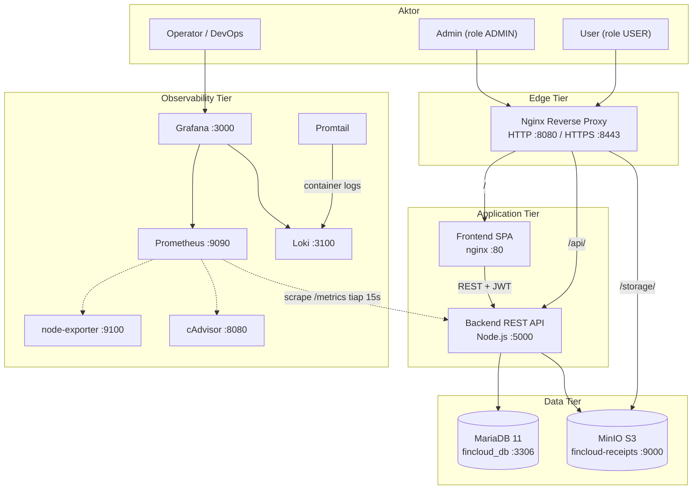

### 2.2 Pembagian Tanggung Jawab

| Lapisan | Komponen | Tanggung jawab |
|---|---|---|
| Edge | Nginx | TLS termination, routing, security header, limit body, proxy `/api/` dan `/storage/` |
| Presentation | Frontend SPA | Render UI, hash routing, simpan JWT, panggil REST API |
| Application | Backend Express | Autentikasi, RBAC, validasi, CRUD transaksi, agregasi, presigning struk, metrik |
| Persistence | MariaDB | Data relasional: user, role, kategori, transaksi, struk, audit |
| Object storage | MinIO | File struk privat (JPG/PNG/WEBP/PDF) |
| Observability | Prometheus + Grafana + Loki + Promtail + exporter | Metrik, log, dashboard, alert |
| Operability | Script backup/restore | Backup harian, verifikasi, restore dengan rollback |

---

## 3. Infrastruktur Finansial

### 3.1 Model Data (ERD)

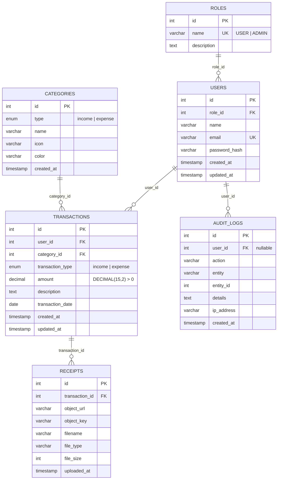

### 3.2 Aturan Integritas & Validasi

**Integritas database (`database/schema.sql`):**

| Aturan | Implementasi |
|---|---|
| Role valid | `users.role_id` → `roles.id`, `ON DELETE RESTRICT` |
| Email unik | `users.email UNIQUE` |
| Tipe transaksi valid | `ENUM('income','expense')` |
| Nominal positif | `amount DECIMAL(15,2)` + `CHECK (amount > 0)` |
| Pemilik transaksi | `transactions.user_id` → `users.id`, `ON DELETE CASCADE` |
| Kategori valid | `transactions.category_id` → `categories.id`, `ON DELETE RESTRICT` |
| Satu transaksi banyak bukti (secara skema) | `receipts.transaction_id` → `transactions.id`, `ON DELETE CASCADE` |
| Audit tetap ada saat user dihapus | `audit_logs.user_id` → `users.id`, `ON DELETE SET NULL` |
| Query cepat | Index `(user_id, transaction_date)`, `category_id`, `audit_logs(user_id/action/created_at)` |

**Validasi API (`backend/src/utils/transactionValidation.js`):**

| Field | Aturan |
|---|---|
| `type` | Wajib `income` atau `expense` |
| `amount` | Angka finite dan `> 0` (menerima numeric string) |
| `category` / `category_id` | Salah satu wajib; nama kategori harus cocok dengan tipe transaksi |
| `date` | Format `YYYY-MM-DD`, tanggal kalender harus nyata (mis. `2026-02-31` ditolak) |
| `description` | Opsional (disimpan sebagai string kosong bila tidak ada) |
| Update parsial | Field yang tidak dikirim mempertahankan nilai lama |
| Pagination | `limit` default 100, diklem 1–1000; `offset` minimal 0 |

### 3.3 Alur Dana & Agregasi Laporan

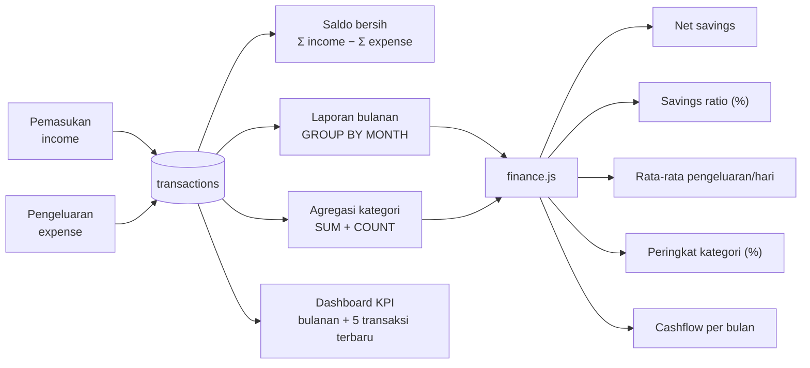

**Sumber angka di backend:**

| Endpoint | Agregasi | Cakupan data |
|---|---|---|
| `GET /api/dashboard` | Total income/expense, saldo, total bulan ini, top 5 kategori pengeluaran, 5 transaksi terbaru | `WHERE user_id = ?` |
| `GET /api/reports/monthly?year=` | `GROUP BY MONTH(transaction_date)` | `WHERE user_id = ? AND YEAR(...) = ?` |
| `GET /api/reports/category?type=&startDate=&endDate=` | `SUM(amount)`, `COUNT(id)` per kategori | `WHERE user_id = ? AND transaction_type = ?` |
| `GET /api/transactions` | `COUNT(*)`, total income/expense untuk filter aktif | `WHERE t.user_id = ?` + filter |

**Perhitungan di frontend (`frontend/js/finance.js`):**

- `netSavings = totalIncome − totalExpense`
- `savingsRatio = round(netSavings / totalIncome × 100)` (0 bila tidak ada pemasukan)
- `avgDailyExpense = round(totalExpense / jumlah hari periode)`
- Persentase kategori = `round(total kategori / total tipe × 100)`
- Cashflow bulanan = `income − expense` per `YYYY-MM`

### 3.4 RBAC & Isolasi Data

| Kapabilitas | USER | ADMIN |
|---|:---:|:---:|
| Register & login | ✅ | ✅ |
| Melihat/mengubah profil sendiri (nama, email) | ✅ | ✅ |
| CRUD transaksi milik sendiri | ✅ | ✅ |
| Melihat transaksi milik user lain lewat API transaksi | ❌ | ❌ |
| `GET /api/admin/users` | ❌ | ✅ |
| `GET /api/admin/audit-logs` | ❌ | ✅ |
| `GET /api/admin/system-status` | ❌ | ✅ |

> Catatan penting: role `ADMIN` **tidak** otomatis melihat transaksi user lain. Endpoint transaksi, dashboard, dan laporan selalu memakai `req.user.id`. Data agregat lintas user hanya tersedia di endpoint admin (jumlah user/transaksi dan volume), bukan detail transaksi.

**Mekanisme:**

- `authenticateToken` memvalidasi `Authorization: Bearer <JWT>`.
  - Tanpa token → `401 Access token required`.
  - Token invalid/kedaluwarsa → `403 Invalid or expired token`.
- `requireRole('ADMIN')` melindungi seluruh `/api/admin/*`.
- JWT berisi `{ id, email, name, role }` dan berlaku 7 hari (`JWT_EXPIRES_IN`).
- Perubahan role tidak tersedia melalui API profil; saat ini hanya lewat data seed/DB.

### 3.5 Audit Trail

Aksi yang dicatat ke `audit_logs`:

| Aksi | Pemicu | Entitas |
|---|---|---|
| `USER_REGISTER` | Registrasi akun | `users` |
| `USER_LOGIN` | Login berhasil | — |
| `FAILED_LOGIN` | Email tidak ada / password salah | — |
| `USER_LOGOUT` | Logout dengan token valid | — |
| `PROFILE_UPDATE` | Ubah nama/email | `users` |
| `TRANSACTION_CREATE` | Tambah transaksi | `transactions` |
| `TRANSACTION_UPDATE` | Ubah transaksi | `transactions` |
| `TRANSACTION_DELETE` | Hapus transaksi | `transactions` |
| `RECEIPT_UPLOAD` | Upload/ganti struk | `receipts` |

Setiap baris menyimpan `user_id`, `action`, `entity`, `entity_id`, `details`, `ip_address`, dan `created_at`.

### 3.6 Bukti Transaksi (Receipts)

- Satu transaksi memiliki **satu** bukti aktif (proses upload menghapus baris lama lalu insert baris baru dalam satu transaksi DB).
- Format yang diterima: `image/jpeg`, `image/png`, `image/webp`, `application/pdf`.
- Ukuran maksimum: **10 MB** (batas multipart), edge Nginx membatasi body **12 MB**.
- Object key: `receipts/{userId}/{transactionId}-{timestamp}-{namaAman}`.
- Metadata disimpan di tabel `receipts`:
  - `object_key` — key internal MinIO
  - `object_url` — path kanonik `/storage/fincloud-receipts/{object_key}`
  - `filename`, `file_type`, `file_size`
- File fisik disimpan di MinIO; database tidak menyimpan blob.
- Akses file selalu melalui **presigned URL** (default 3600 detik, diklem 60 detik–7 hari).
- Bucket bersifat privat; policy public-read lama dihapus otomatis saat startup.

---

## 4. Infrastruktur Komputasi & Cloud

### 4.1 Topologi Deployment

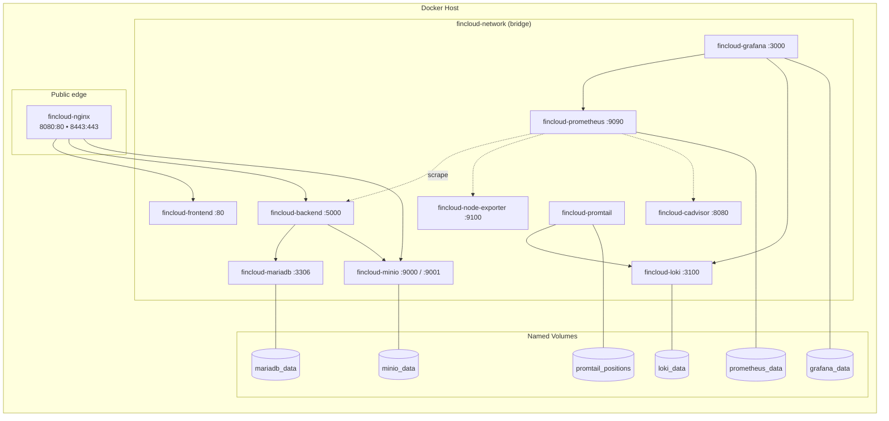

### 4.2 Daftar Service

| # | Service | Container | Image | Port internal | Port host | Fungsi |
|---:|---|---|---|---|---|---|
| 1 | `mariadb` | `fincloud-mariadb` | `mariadb:11` | 3306 | `127.0.0.1:3306` | Database relasional |
| 2 | `backend` | `fincloud-backend` | build `node:22-alpine` | 5000 | `127.0.0.1:5000` | REST API, JWT, metrik, presigning |
| 3 | `minio` | `fincloud-minio` | `pgsty/minio` | 9000 / 9001 | `127.0.0.1:9000` / `9001` | Object storage + console |
| 4 | `frontend` | `fincloud-frontend` | build `nginx:alpine` | 80 | — | Serve SPA statis |
| 5 | `certs` | `fincloud-certs` | `alpine/openssl:3.3.3` | — | — | Generate self-signed TLS (one-shot) |
| 6 | `nginx` | `fincloud-nginx` | `nginx:alpine` | 80 / 443 | `8080` / `8443` | Edge proxy, TLS, routing |
| 7 | `node-exporter` | `fincloud-node-exporter` | `prom/node-exporter:v1.8.2` | 9100 | `127.0.0.1:9100` | Metrik host |
| 8 | `cadvisor` | `fincloud-cadvisor` | `gcr.io/cadvisor/cadvisor:v0.52.0` | 8080 | `127.0.0.1:8081` | Metrik container |
| 9 | `prometheus` | `fincloud-prometheus` | `prom/prometheus:v2.55.1` | 9090 | `127.0.0.1:9090` | Scrape & evaluasi alert |
| 10 | `loki` | `fincloud-loki` | `grafana/loki:3.2.1` | 3100 | `127.0.0.1:3100` | Agregasi log |
| 11 | `promtail` | `fincloud-promtail` | `grafana/promtail:3.2.0` | 9080 | — | Kirim log container ke Loki |
| 12 | `grafana` | `fincloud-grafana` | `grafana/grafana:11.3.0` | 3000 | `127.0.0.1:3001` | Dashboard & eksplorasi log |

**Urutan dependensi startup:**

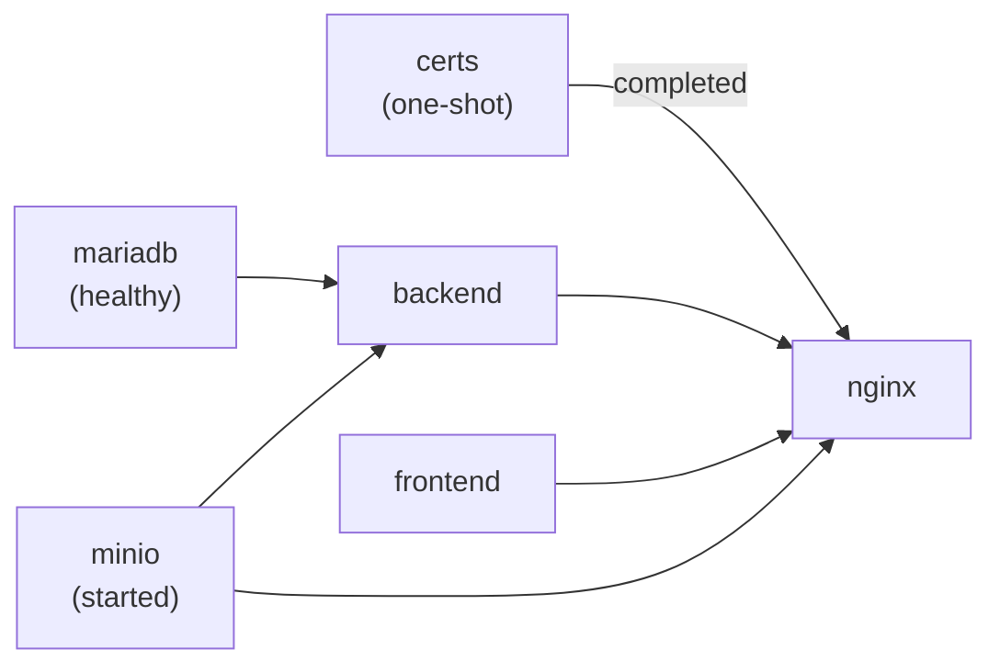

- `backend` menunggu `mariadb` **healthy** dan `minio` started.
- `nginx` menunggu `certs` selesai, `frontend`, `backend`, dan `minio`.
- `certs` tidak membuat ulang sertifikat bila `fincloud.crt` dan `fincloud.key` sudah ada.

### 4.3 Edge Nginx

**Routing:**

| Path | Target | Perilaku |
|---|---|---|
| `/` | `frontend:80` | SPA statis, fallback `index.html` |
| `/api/` | `backend:5000` | Proxy REST, Host asli diteruskan |
| `/api` | redirect `308 /api/` | Normalisasi trailing slash |
| `/storage/` | `minio:9000` | Prefix `/storage` **dihilangkan** sebelum proxy |
| `/storage` | redirect `308 /storage/` | Normalisasi trailing slash |
| `/minio/` | `404` | Console MinIO sengaja tidak diekspos |
| `/nginx-health` | `200 ok` | Healthcheck container |

**Keamanan & batas:**

- `server_tokens off`, `proxy_hide_header Server`.
- Header respons: `X-Frame-Options SAMEORIGIN`, `X-Content-Type-Options nosniff`, `Referrer-Policy strict-origin-when-cross-origin`, `X-XSS-Protection 1; mode=block`.
- HTTPS menambahkan `Strict-Transport-Security max-age=31536000; includeSubDomains`.
- TLS 1.2/1.3, session cache 10 MB, timeout 1 hari, stapling nonaktif (self-signed).
- `client_max_body_size 12m`.
- Timeout: API 10s connect / 60s read-send; storage 10s connect / 300s read-send.
- `proxy_buffering off` untuk `/storage/` agar file stream langsung.

**Catatan SigV4:** Host header diteruskan apa adanya karena merupakan bagian dari tanda tangan presigned URL. Prefix `/storage` ditambahkan setelah signing lalu di-strip oleh Nginx, sehingga canonical URI tetap valid.

### 4.4 Application Tier

| Aspek | Konfigurasi |
|---|---|
| Runtime | Node.js 22 Alpine, `PORT=5000`, `NODE_ENV=production` |
| Framework | Express 4, `x-powered-by` dimatikan |
| Body parser | JSON 10 MB, URL-encoded extended |
| Trust proxy | `1` (satu hop Nginx) agar `req.protocol`/presign mengikuti HTTP/HTTPS browser |
| CORS | Allowlist `CORS_ORIGINS`; default `localhost:3000`, `127.0.0.1:3000`, `localhost:8080`, `https://localhost:8443` |
| CORS detail | `credentials: true`, method GET/POST/PUT/PATCH/DELETE/OPTIONS, header `Content-Type` & `Authorization`, preflight cache 24 jam |
| Auth | JWT Bearer, `bcryptjs` salt rounds 10 |
| Logging | Satu baris per request: timestamp, method, URL, status, durasi |
| Metrik | Middleware `prom-client`, endpoint internal `/metrics` |
| Storage | AWS S3 SDK (`@aws-sdk/client-s3`), path-style, region default `us-east-1` |
| Upload | Multer memory storage, 10 MB, MIME allowlist |
| Pagination | `limit` 1–1000 (default 100), `offset` ≥ 0 |

**Alias route autentikasi:** `authRoutes` dipasang di `/api` **dan** `/api/auth`, sehingga `/api/login` dan `/api/auth/login` sama-sama valid. Frontend memakai `/api/auth/*`.

### 4.5 Data Tier

| Aspek | Konfigurasi |
|---|---|
| Engine | MariaDB 11, InnoDB, `utf8mb4_unicode_ci` |
| Inisialisasi | `database/schema.sql` lalu `database/seed.sql` (volume kosong) |
| Volume | `mariadb_data` → `/var/lib/mysql` |
| Healthcheck | `healthcheck.sh --connect --innodb_initialized`, interval 10s, retry 10, start period 30s |
| Koneksi backend | `DB_HOST=mariadb`, `DB_PORT=3306`, pool 10 koneksi, keep-alive |
| Akses host | Hanya `127.0.0.1:3306` untuk tooling lokal |
| Seed user | `user@fincloud.local`, `admin@fincloud.local` (password `password123`) |
| Seed data | 6 transaksi contoh untuk user ID 1 + 3 audit log awal |

**Catatan:** skrip inisialisasi hanya berjalan saat volume database masih kosong. Perubahan skema setelah volume terbentuk harus dilakukan sebagai migrasi manual.

### 4.6 Storage Tier (MinIO)

| Aspek | Konfigurasi |
|---|---|
| Endpoint internal backend | `http://minio:9000` |
| Endpoint publik (browser) | `http://localhost:8080/storage/...` |
| Bucket | `fincloud-receipts` (privat) |
| Inisialisasi | `ensureBucket()` retry 10× dengan jeda 2 detik; hapus policy public-read lama |
| Presign | Default 3600 detik, diklem 60 detik–7 hari |
| Path kanonik DB | `/storage/fincloud-receipts/{objectKey}` |
| Resolusi origin | Mengikuti `X-Forwarded-Proto` dan `X-Forwarded-Host` dari Nginx |
| Akses anonim | Ditolak (bucket privat) |
| Console | Port 9001 di-bind loopback; `/minio/` via edge → 404 |

**Alur upload atomik:**

1. Upload objek baru ke MinIO terlebih dahulu.
2. Buka transaksi DB: hapus baris `receipts` lama, insert baris baru, commit.
3. Bila insert DB gagal → rollback + hapus objek baru (objek lama tetap utuh).
4. Setelah commit → hapus objek lama (best-effort).

### 4.7 Frontend Tier

| Aspek | Konfigurasi |
|---|---|
| Serving | Container `nginx:alpine`, root `/usr/share/nginx/html` |
| Cache | `index.html` selalu `no-store`; aset statis mengikuti default |
| Routing | Hash router: `#/login`, `#/register`, `#/dashboard`, `#/transactions`, `#/reports`, `#/profile` |
| Session | JWT di `localStorage` (`fincloud_token`), profil di `fincloud_current_user`, tema di `fincloud_theme` |
| Guard | Token ada + belum kedaluwarsa + user ada; jika tidak → hapus sesi & redirect `#/login` |
| Deteksi API | `window.FINCLOUD_API_BASE` → `fincloud_api_base` → port dev (`3000/5173/5500/8000/4173`) memakai `http://<host>:5000/api` → selain itu `/api` |
| HTTP client | Timeout request 20 detik, upload 60 detik, header Bearer otomatis |
| 401 handling | Event `fincloud:unauthorized` → bersihkan sesi → login |
| Logout | Panggil `POST /api/auth/logout` (best-effort), lalu bersihkan token + user |
| Data legacy | Key mock lama (`fincloud_transactions`, `fincloud_registered_users`) dihapus saat login/register |

### 4.8 Jaringan, Port, dan Volume

**Matriks port:**

| Port host | Binding | Service | Keterangan |
|---:|---|---|---|
| 8080 | `0.0.0.0` | Nginx HTTP | Pintu masuk publik |
| 8443 | `0.0.0.0` | Nginx HTTPS | Pintu masuk publik (self-signed default) |
| 5000 | `127.0.0.1` | Backend | Debug/tes lokal |
| 3306 | `127.0.0.1` | MariaDB | Tooling DB lokal |
| 9000 | `127.0.0.1` | MinIO API | Tooling S3 lokal |
| 9001 | `127.0.0.1` | MinIO Console | Admin storage |
| 9100 | `127.0.0.1` | node-exporter | Debug metrik host |
| 8081 → 8080 | `127.0.0.1` | cAdvisor | UI metrik container |
| 9090 | `127.0.0.1` | Prometheus | Query & status alert |
| 3100 | `127.0.0.1` | Loki | Query log |
| 3001 → 3000 | `127.0.0.1` | Grafana | Dashboard |

**Volume:**

| Volume | Mount | Isi |
|---|---|---|
| `mariadb_data` | `/var/lib/mysql` | Seluruh data relasional |
| `minio_data` | `/data` | Objek struk |
| `prometheus_data` | `/prometheus` | TSDB metrik (retensi 15 hari) |
| `grafana_data` | `/var/lib/grafana` | State Grafana |
| `loki_data` | `/loki` | Chunk & index log |
| `promtail_positions` | `/tmp` | Posisi baca log |

---

## 5. Alur Kritis

### 5.1 Login, Guard, dan Logout

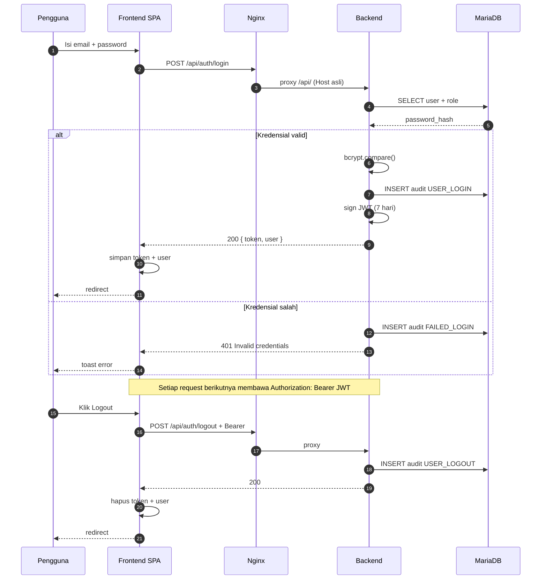

**Guard rute:**

- Rute publik: `/login`, `/register`.
- Rute terproteksi: `/dashboard`, `/transactions`, `/reports`, `/profile`.
- Tanpa sesi valid → `#/login`.
- Sudah login lalu membuka `/login`/`/register` → `#/dashboard`.
- Token kedaluwarsa/rusak → sesi dibersihkan otomatis.

### 5.2 CRUD Transaksi

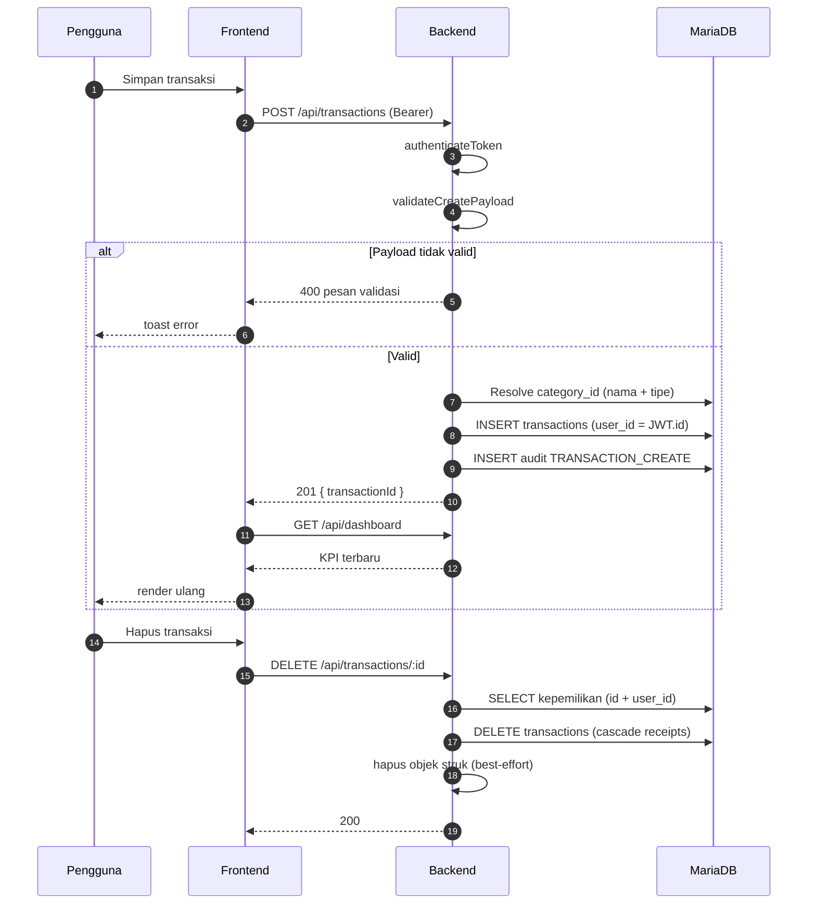

**Kepemilikan:** semua operasi `GET/PUT/DELETE` memakai `WHERE id = ? AND user_id = ?`. Transaksi milik user lain menghasilkan `404` (bukan `403`) agar tidak membocorkan keberadaan data.

### 5.3 Upload Struk

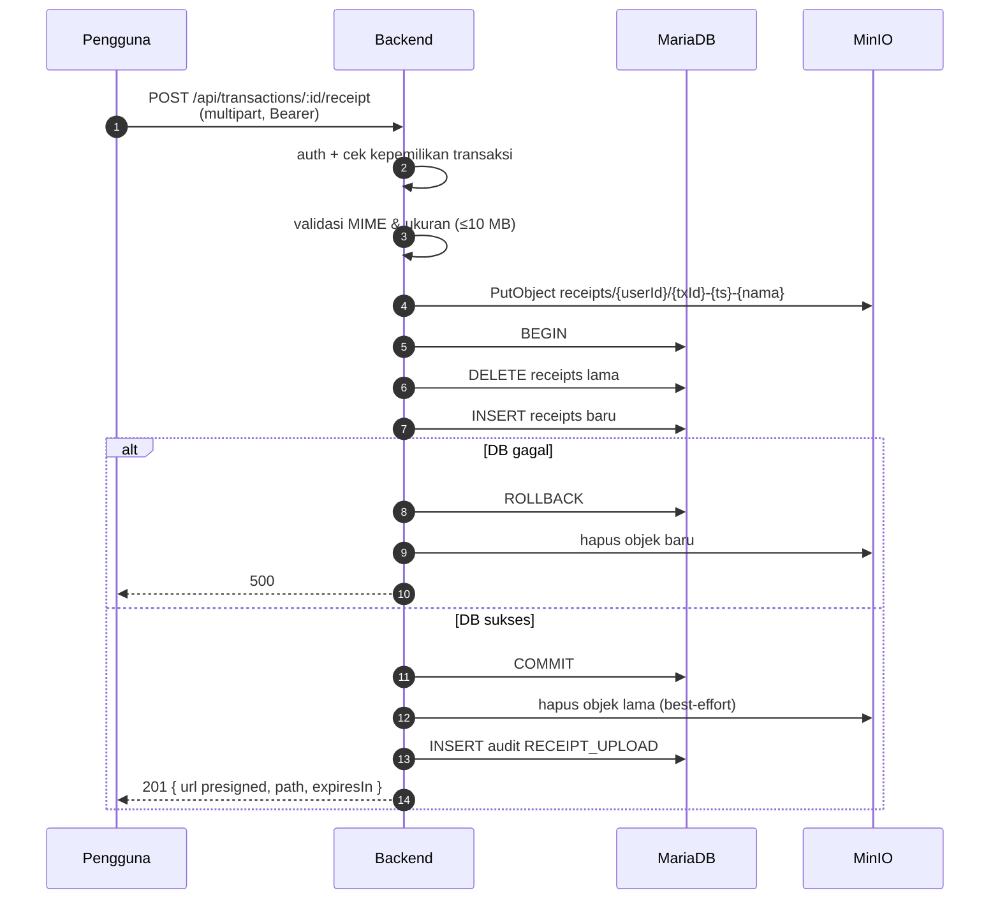

### 5.4 Melihat Struk (Presigned URL)

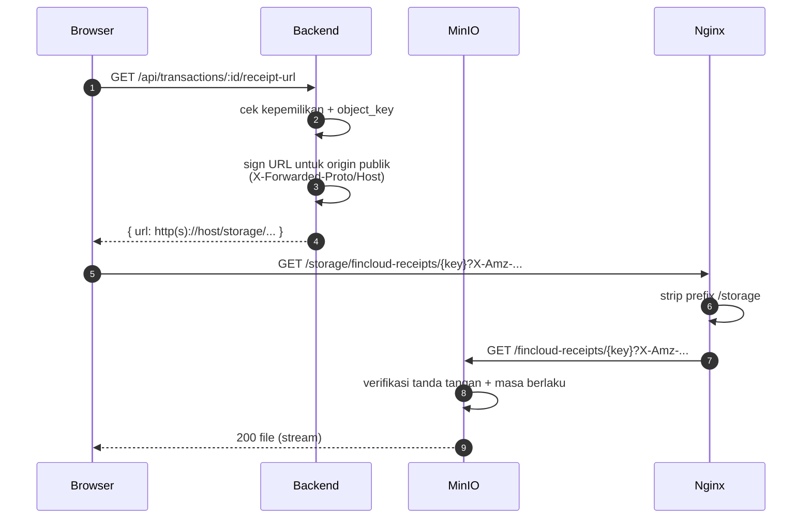

**Masa berlaku:** default 1 jam. Frontend meminta URL baru lewat `/receipt-url` bila tautan kedaluwarsa.

---

## 6. Observability & Operability

### 6.1 Metrik

Backend mengekspos `/metrics` (internal, tidak lewat edge) memakai `prom-client`.

| Metrik | Tipe | Label | Makna |
|---|---|---|---|
| `fincloud_http_requests_total` | Counter | `method`, `route`, `status` | Jumlah request HTTP |
| `fincloud_http_request_duration_seconds` | Histogram | `method`, `route`, `status` | Latensi request (bucket 5ms–10s) |
| `fincloud_transactions_created_total` | Counter | `type` | Transaksi dibuat per tipe |
| `fincloud_receipt_uploads_total` | Counter | `result` | Hasil upload struk |
| `fincloud_receipt_upload_bytes_total` | Counter | — | Total byte struk terunggah |
| `fincloud_auth_attempts_total` | Counter | `result` | Login: `success`, `invalid_credentials`, `invalid_request`, `error` |
| `fincloud_db_up` | Gauge | — | 1/0 konektivitas MariaDB |
| `fincloud_storage_up` | Gauge | — | 1/0 konektivitas MinIO |
| `fincloud_*` default metrics | Gauge/Counter | — | CPU, memori, event loop, GC, dll. |

Label `route` memakai pola rute Express (mis. `/api/transactions/:id`) agar cardinality tetap rendah.

### 6.2 Scrape & Penyimpanan

| Job | Target | Path | Interval |
|---|---|---|---|
| `prometheus` | `localhost:9090` | default | 15s |
| `fincloud-backend` | `backend:5000` | `/metrics` | 15s |
| `node-exporter` | `node-exporter:9100` | default | 15s |
| `cadvisor` | `cadvisor:8080` | default | 15s |

- `scrape_timeout` 10s, `evaluation_interval` 15s, external label `stack=fincloud`.
- Retensi TSDB Prometheus: **15 hari**.
- cAdvisor di-relabel agar label `service` menampilkan nama service yang mudah dibaca.

### 6.3 Log Terpusat

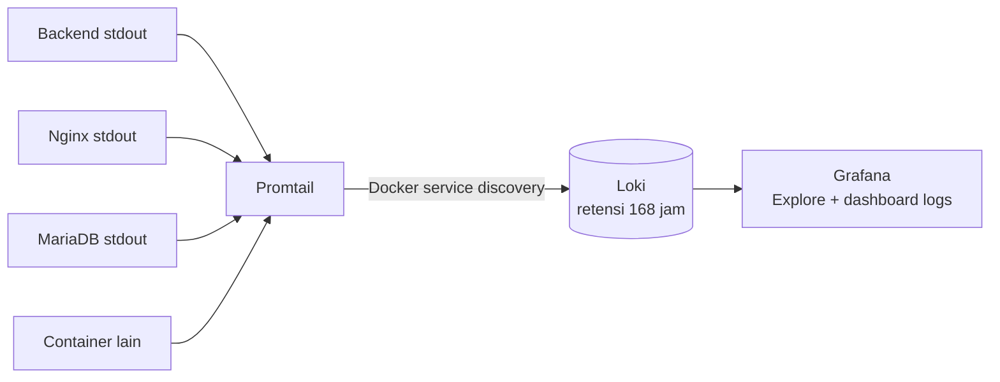

- Promtail menemukan container lewat Docker socket (read-only) dan menambahkan label `container`, `stream`, `service`, `project`.
- Loki single-node, penyimpanan filesystem, schema v13 (TSDB), compaction tiap 10 menit.
- Retensi log: **7 hari** (`168h`), sampel lebih lama ditolak.

### 6.4 Dashboard Grafana

| Dashboard | UID | Panel | Fokus |
|---|---|---:|---|
| FinCloud Overview | `fincloud-overview` | 22 | Kesehatan layanan, trafik, error rate, latensi, ringkasan bisnis |
| FinCloud Infrastructure & Containers | `fincloud-infra` | 19 | CPU/memori/disk host, metrik container, konektivitas DB/storage |
| FinCloud Logs & Audit Trail | `fincloud-logs` | 3 | Log container dan audit trail |

- Datasource: Prometheus (`uid: prometheus`, default) dan Loki (`uid: loki`).
- Provisioning otomatis dari `infra/grafana/provisioning`, folder `FinCloud`, refresh 30 detik.

### 6.5 Alert Rules

Prometheus mengevaluasi **13 alert**:

| # | Alert | Kondisi inti | Severity | For |
|---:|---|---|---|---|
| 1 | `FinCloudBackendDown` | `up{job="fincloud-backend"} == 0` | critical | 1m |
| 2 | `FinCloudHighErrorRate` | rasio 5xx > 5% (5m) | warning | 5m |
| 3 | `FinCloudHighLatencyP95` | p95 latensi > 1s | warning | 5m |
| 4 | `FinCloudDatabaseDown` | `fincloud_db_up == 0` | critical | 2m |
| 5 | `FinCloudStorageDown` | `fincloud_storage_up == 0` | critical | 2m |
| 6 | `FinCloudHostHighCPU` | CPU host > 85% | warning | 10m |
| 7 | `FinCloudHostHighMemory` | memori host > 90% | warning | 10m |
| 8 | `FinCloudHostDiskLow` | disk tersisa < 10% | warning | 10m |
| 9 | `FinCloudNodeExporterDown` | `up{job="node-exporter"} == 0` | warning | 2m |
| 10 | `FinCloudCadvisorDown` | `up{job="cadvisor"} == 0` | warning | 2m |
| 11 | `FinCloudBackupStale` | backup sukses terakhir > 26 jam | warning | 0s |
| 12 | `FinCloudBackupFailed` | attempt terakhir gagal | critical | 0s |
| 13 | `FinCloudBackupMetricsMissing` | metrik backup tidak ada | warning | 0s |

> Stack ini belum menyertakan **Alertmanager**, sehingga alert terekam dan terlihat di Prometheus/Grafana tetapi belum dikirim ke email/Slack/Telegram. Lihat bagian [Batasan & Rekomendasi](#10-batasan--rekomendasi-produksi).

### 6.6 Diagram Alur Observability

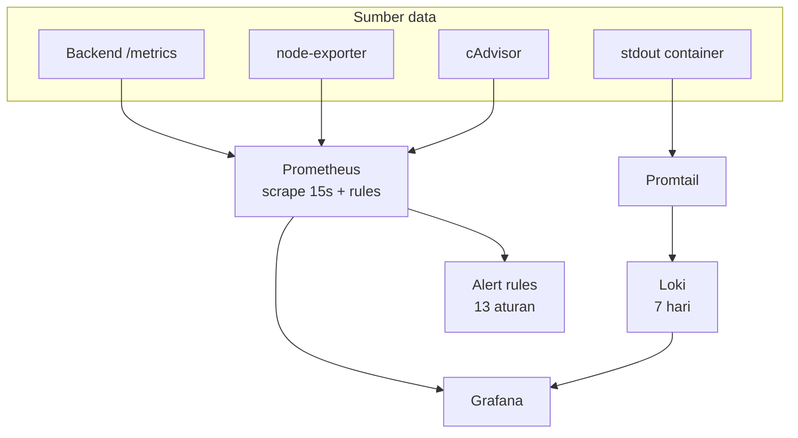

---

## 7. Backup & Disaster Recovery

### 7.1 Ruang Lingkup & Artefak

Backup mencakup dua aset kritis:

1. **Database** `fincloud_db` — schema, data, routine, trigger, event (dump konsisten `--single-transaction`).
2. **Object storage** bucket `fincloud-receipts` — file struk.

Artefak per run (folder `backups/YYYYMMDD-HHMMSS/`):

| File | Isi |
|---|---|
| `fincloud_db.sql.gz` | Dump database terkompresi |
| `receipts.tar.gz` | Arsip bucket (kecuali `--skip-storage`) |
| `manifest.json` | Metadata, row count, checksum SHA-256 |
| `SHA256SUMS.txt` | Checksum seluruh artefak |
| `backup.log` | Log eksekusi |

`backups/last-backup.txt` menyimpan path backup terakhir. Folder `backups/` di-ignore dari Git karena berisi data pengguna dan hash password.

### 7.2 Alur Backup

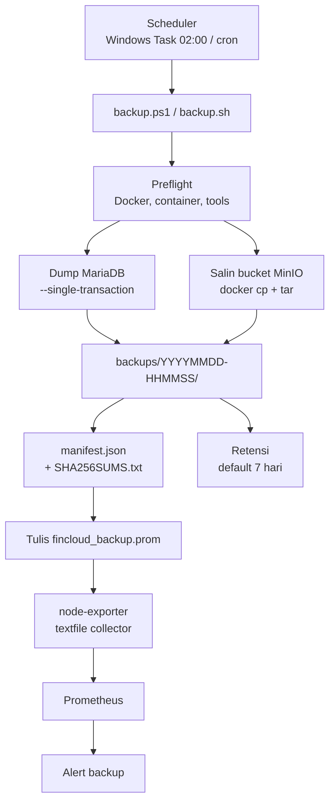

**Opsi penting:**

- `-OutputRoot` / `--output` — lokasi backup.
- `-RetentionDays` / `--retention-days` — retensi (default dari `BACKUP_RETENTION_DAYS`, umumnya 7).
- `-SkipStorage` / `--skip-storage` — hanya database.
- `-DryRun` / `--dry-run` — cek prasyarat tanpa menulis file.

### 7.3 Verifikasi & Restore

| Operasi | Perilaku |
|---|---|
| Verifikasi (`-VerifyOnly`) | Restore ke database scratch `fincloud_restore_test`, bandingkan row count dengan manifest, lalu hapus scratch |
| Restore database + storage | Restore penuh dari folder backup |
| Restore database saja | `-DatabaseOnly` |
| Pengaman restore | Snapshot pra-restore otomatis + rollback bila gagal |
| Konfirmasi | Flag `-Force` / `--force` wajib |

### 7.4 Jadwal, Retensi, dan Target

| Parameter | Nilai |
|---|---|
| Jadwal default | Setiap hari 02:00 (Windows Task Scheduler / cron) |
| Retensi default | 7 hari |
| RPO | 24 jam + toleransi 2 jam → alert jika > 26 jam |
| RTO | ±20 detik untuk restore penuh (hasil drill terdokumentasi) |
| Verifikasi | Checksum SHA-256 + perbandingan row count |
| Lokasi | `backups/` lokal; disarankan salinan offsite terenkripsi |

> Hasil drill terdokumentasi pada `docs/24-backup-drill-report.md`: backup ±4,46 detik, `VERIFY OK`, restore penuh ±20,4 detik, dan E2E 78/78 lulus. Angka ini berasal dari laporan drill, bukan pengukuran ulang pada dokumen ini.

### 7.5 Metrik & Alert Backup

Script menulis metrik Prometheus ke `infra/node-exporter/textfile/fincloud_backup.prom`:

- `fincloud_backup_last_success_timestamp_seconds`
- `fincloud_backup_last_attempt_success` (1/0)

Alert terkait: `FinCloudBackupStale`, `FinCloudBackupFailed`, `FinCloudBackupMetricsMissing`.

---

## 8. Keamanan

### 8.1 Matriks Kontrol

| Area | Kontrol | Implementasi |
|---|---|---|
| Password | Hash kuat | bcrypt, salt rounds 10 |
| Sesi | Token bertanda tangan | JWT HS256, payload minimal, expiry 7 hari |
| Otorisasi | RBAC | `authenticateToken` + `requireRole('ADMIN')` |
| Isolasi data | Scoping per user | Semua query transaksi/dashboard/laporan memakai `user_id` dari JWT |
| Transport | TLS | TLS 1.2/1.3, HSTS di HTTPS, self-signed default |
| CORS | Allowlist | Hanya origin yang terdaftar, credentials diizinkan |
| Header | Hardening | `nosniff`, `SAMEORIGIN`, `Referrer-Policy`, `X-XSS-Protection`, `server_tokens off` |
| Upload | Validasi | MIME allowlist, maksimum 10 MB, nama file disanitasi |
| Object storage | Privat | Bucket tanpa public policy, akses via presigned URL |
| Eksposur | Least privilege | DB, MinIO, Prometheus, Loki, Grafana di-bind `127.0.0.1` |
| Secret | Tidak di repo | `.env` di-ignore; password tidak ditulis ke log |
| Audit | Trail | Login, logout, kegagalan login, perubahan profil, CRUD transaksi, upload struk |
| Error | Informasi minimal | Pesan 500 generik di production (`NODE_ENV=production`) |

### 8.2 Zona Keamanan

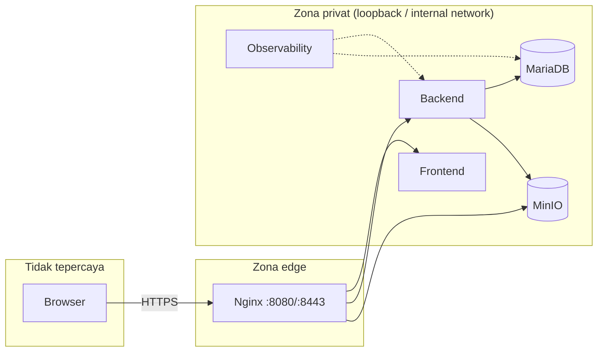

### 8.3 Risiko yang Perlu Dicatat

- JWT disimpan di `localStorage` → rentan bila terjadi XSS; belum ada CSP.
- Belum ada rate limiting / brute-force protection pada login.
- Sertifikat default self-signed → browser memunculkan peringatan.
- Belum ada MFA.
- Alert belum punya kanal notifikasi (tanpa Alertmanager).
- Secret masih berupa file `.env` di host.

---

## 9. Operasional Harian

### 9.1 Perintah Utama

```powershell
# Jalankan seluruh stack (build image bila berubah)
docker compose up -d --build

# Status & kesehatan
docker compose ps
docker compose logs -f backend

# Health check melalui edge
curl http://localhost:8080/api/health

# Hentikan stack (volume tetap)
docker compose down
```

**Contoh respons health check:**

```json
{
  "status": "UP",
  "timestamp": "2026-11-19T02:33:38.293Z",
  "database": { "connected": true, "message": "MariaDB Connected" },
  "storage": { "connected": true, "bucket": "fincloud-receipts" }
}
```

### 9.2 Akses Layanan

| Layanan | URL |
|---|---|
| Aplikasi (HTTP) | `http://localhost:8080` |
| Aplikasi (HTTPS) | `https://localhost:8443` (self-signed) |
| Grafana | `http://127.0.0.1:3001` |
| Prometheus | `http://127.0.0.1:9090` |
| MinIO Console | `http://127.0.0.1:9001` |
| cAdvisor | `http://127.0.0.1:8081` |

### 9.3 Akun Demo

| Role | Email | Password |
|---|---|---|
| USER | `user@fincloud.local` | `password123` |
| ADMIN | `admin@fincloud.local` | `password123` |

Halaman login juga menyediakan tombol **Demo Quick Login** yang memanggil API login dengan akun seed di atas.

### 9.4 Endpoint API

| Method | Endpoint | Auth | Fungsi |
|---|---|---|---|
| POST | `/api/auth/register` | — | Registrasi (role baru default `USER`) |
| POST | `/api/auth/login` | — | Login, mengembalikan JWT |
| POST | `/api/auth/logout` | Bearer | Audit logout |
| GET | `/api/auth/profile` | Bearer | Profil user aktif |
| PUT | `/api/auth/profile` | Bearer | Ubah nama/email sendiri |
| GET | `/api/transactions` | Bearer | List/filter/cari + pagination + summary |
| GET | `/api/transactions/categories` | Bearer | Daftar kategori |
| GET | `/api/transactions/:id` | Bearer | Detail transaksi milik sendiri |
| POST | `/api/transactions` | Bearer | Buat transaksi |
| PUT | `/api/transactions/:id` | Bearer | Ubah transaksi |
| DELETE | `/api/transactions/:id` | Bearer | Hapus transaksi + struk |
| POST | `/api/transactions/:id/receipt` | Bearer | Upload/ganti struk |
| DELETE | `/api/transactions/:id/receipt` | Bearer | Hapus struk |
| GET | `/api/transactions/:id/receipt-url` | Bearer | Presigned URL baru |
| GET | `/api/dashboard` | Bearer | KPI dashboard |
| GET | `/api/reports/monthly?year=` | Bearer | Rekap bulanan |
| GET | `/api/reports/category?type=&startDate=&endDate=` | Bearer | Rekap kategori |
| GET | `/api/admin/users` | Bearer + ADMIN | Daftar user + agregat transaksi |
| GET | `/api/admin/audit-logs?limit=&offset=` | Bearer + ADMIN | Audit log |
| GET | `/api/admin/system-status` | Bearer + ADMIN | Status runtime & statistik platform |
| GET | `/api/health` | — | Health check DB + storage |
| GET | `/metrics` | — | Metrik Prometheus (internal) |

> `POST /api/login`, `/api/register`, `/api/logout`, `/api/profile` juga tersedia sebagai alias tanpa segmen `/auth`.

### 9.5 Variabel Lingkungan Penting

| Variabel | Fungsi |
|---|---|
| `NGINX_HTTP_PORT`, `NGINX_HTTPS_PORT` | Port publik edge (default 8080/8443) |
| `MARIADB_ROOT_PASSWORD`, `MARIADB_PASSWORD` | Inisialisasi MariaDB (wajib) |
| `DB_NAME`, `DB_USER`, `DB_PASSWORD` | Kredensial aplikasi ke database |
| `JWT_SECRET`, `JWT_EXPIRES_IN` | Tanda tangan & masa berlaku token |
| `CORS_ORIGINS` | Allowlist origin browser |
| `MINIO_ROOT_USER`, `MINIO_ROOT_PASSWORD` | Kredensial admin MinIO |
| `MINIO_ACCESS_KEY`, `MINIO_SECRET_KEY` | Kredensial S3 backend |
| `MINIO_BUCKET`, `MINIO_REGION` | Bucket & region signing |
| `MINIO_PUBLIC_ENDPOINT`, `MINIO_PUBLIC_PORT`, `MINIO_PUBLIC_USE_SSL`, `MINIO_PUBLIC_PATH_PREFIX` | Origin publik untuk presigned URL |
| `MINIO_PRESIGN_EXPIRES` | TTL presigned URL (default 3600s) |
| `PROMETHEUS_PORT`, `LOKI_PORT`, `GRAFANA_PORT`, `NODE_EXPORTER_PORT`, `CADVISOR_PORT` | Port loopback monitoring |
| `GRAFANA_ADMIN_USER`, `GRAFANA_ADMIN_PASSWORD` | Admin Grafana |
| `BACKUP_DIR`, `BACKUP_RETENTION_DAYS`, `BACKUP_TIME` | Konfigurasi backup |

Nilai rahasia **tidak** dicantumkan di dokumen ini; lihat `.env` lokal (tidak di-commit).

### 9.6 Mode Pengembangan Lokal

```powershell
# Terminal 1 — backend (port 5000)
cd backend
npm install
npm run dev

# Terminal 2 — frontend (port 3000)
cd frontend
npm run dev
```

Frontend otomatis mengarah ke `http://<host>:5000/api` saat dijalankan di port 3000/5173/5500/8000/4173. Backend memerlukan `backend/.env` dengan kredensial DB/MinIO/JWT yang sesuai.

### 9.7 Pengujian

| Suite | Perintah | Cakupan |
|---|---|---|
| Frontend unit | `cd frontend && npm test` | Kalkulasi finansial, store, API client, presigned URL resolution |
| Backend unit | `cd backend && npm test` | Keamanan password/JWT, CORS, storage prefix, validasi transaksi |
| E2E | `node tests/e2e/transactions.e2e.mjs` | Login, CRUD, upload struk, presigned, dashboard, laporan, isolasi data, RBAC |

**Hasil verifikasi pada kondisi repo saat dokumen ini disusun:**

- Frontend: **14/14** test lulus.
- Backend: **26/26** test lulus.
- E2E: script tersedia; hasil drill terakhir terdokumentasi **78/78** pada `docs/24-backup-drill-report.md`.

---

## 10. Batasan & Rekomendasi Produksi

| Area | Kondisi saat ini | Rekomendasi |
|---|---|---|
| TLS | Self-signed, stapling off | Gunakan sertifikat CA tepercaya (Let's Encrypt/internal CA), aktifkan OCSP stapling |
| High availability | MariaDB & MinIO single node | Replikasi MariaDB, MinIO distributed/erasure coding, load balancer |
| Secrets | `.env` di host | Secret manager (Vault/Docker secret/cloud KMS), rotasi berkala |
| Sesi | JWT di `localStorage`, 7 hari | Pertimbangkan cookie `HttpOnly` + `Secure` + `SameSite`, refresh token, TTL lebih pendek |
| Proteksi login | Tanpa rate limit | Tambahkan rate limiting, lockout, CAPTCHA, MFA |
| XSS | Belum ada CSP | Tambahkan `Content-Security-Policy` yang ketat di edge |
| Alerting | Prometheus rules tanpa notifikasi | Deploy Alertmanager + kanal email/Slack/Telegram |
| Log | Loki filesystem, 7 hari | Object storage backend, retensi sesuai kebijakan audit |
| Metrik | Retensi TSDB 15 hari | Remote storage/Thanos untuk retensi panjang |
| Backup | Lokal, retensi 7 hari | Salinan offsite terenkripsi, uji restore berkala, kebijakan 3-2-1 |
| Skema DB | Init SQL, tanpa migrasi | Tools migrasi (Flyway/Prisma/Liquibase), versioning skema |
| Role management | Hanya via seed/DB | Endpoint admin untuk mengelola role + audit perubahan |
| Rate/limit upload | 10 MB per file | Sesuaikan kuota, antivirus scanning, validasi isi file |
| Observability bisnis | Metrik terbatas | Tambahkan metrik funnel, error budget, SLO dashboard |

---

## 11. Referensi

### Kode & Konfigurasi

| Topik | File |
|---|---|
| Orkestrasi container | `docker-compose.yml` |
| Skema & seed DB | `database/schema.sql`, `database/seed.sql` |
| Edge routing & TLS | `infra/nginx/nginx.conf`, `infra/nginx/fincloud-locations.conf` |
| Prometheus | `infra/prometheus/prometheus.yml`, `infra/prometheus/alert.rules.yml` |
| Loki & Promtail | `infra/loki/loki-config.yml`, `infra/loki/promtail-config.yml` |
| Grafana provisioning | `infra/grafana/provisioning/**`, `infra/grafana/dashboards/*.json` |
| Backend entrypoint | `backend/src/server.js` |
| Autentikasi | `backend/src/routes/auth.js`, `backend/src/middleware/auth.js` |
| Transaksi | `backend/src/routes/transactions.js`, `backend/src/utils/transactionValidation.js` |
| Dashboard & laporan | `backend/src/routes/dashboard.js`, `backend/src/routes/reports.js` |
| Admin | `backend/src/routes/admin.js` |
| Object storage | `backend/src/config/storage.js` |
| Metrik | `backend/src/config/metrics.js` |
| CORS | `backend/src/middleware/cors.js` |
| Frontend API client | `frontend/js/api.js`, `frontend/js/config.js` |
| Frontend state & guard | `frontend/js/store.js`, `frontend/js/router.js` |
| Kalkulasi laporan | `frontend/js/finance.js` |
| Backup & restore | `scripts/backup.ps1`, `scripts/backup.sh`, `scripts/restore.ps1`, `scripts/restore.sh` |
| E2E test | `tests/e2e/transactions.e2e.mjs` |

### Dokumen Terkait

| Dokumen | Isi |
|---|---|
| `docs/05-erd-draft.md` | Draf ERD awal |
| `docs/13-use-case.md` | Use case platform |
| `docs/22-test-checklist-qa-report.md` | Checklist & laporan QA |
| `docs/23-sop-backup-recovery.md` | SOP backup & recovery |
| `docs/24-backup-drill-report.md` | Laporan drill backup/restore |
| `docs/DOKUMENTASI_LENGKAP.md` | Dokumentasi proyek lengkap |

---

*Dokumen ini menggambarkan kondisi teknis repositori pada November 2026. Perbarui bila ada perubahan skema, service, port, atau kebijakan operasional.*
