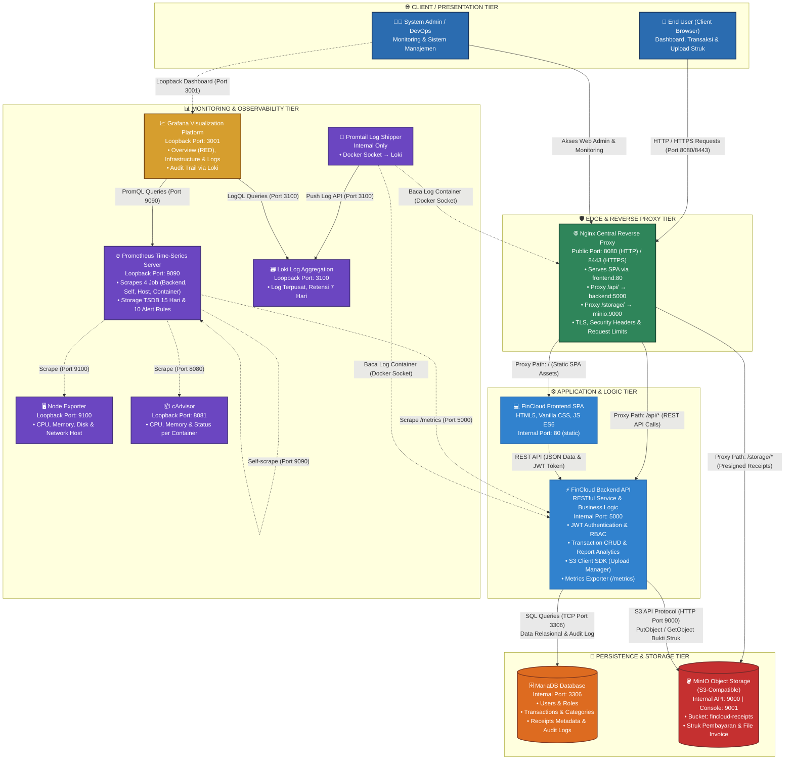

# Diagram & Spesifikasi Arsitektur Sistem FinCloud

Dokumen ini menjelaskan arsitektur sistem **FinCloud (Cloud-Based Financial Management & Monitoring Platform)** yang dikembangkan oleh tim **Cloud9**. Arsitektur ini mengadopsi pola *layered cloud-native architecture* yang memisahkan antarmuka pengguna, reverse proxy, layanan backend, persistensi data relasional, penyimpanan berkas objek, dan sistem observabilitas.

---

## 1. Diagram Arsitektur (Mermaid)

---

## 2. Rincian Komponen Arsitektur

| Komponen | Layer / Tier | Port Standar | Peran & Tanggung Jawab Utama |
|---|---|---|---|
| **Frontend (SPA)** | Client / Web App | `3000` | Antarmuka pengguna berbasis Single Page Application (HTML5, Vanilla CSS, JS ES6). Mengelola routing sisi klien (`#/dashboard`, `#/transactions`, `#/reports`), state management, visualisasi grafik canvas, dan interaksi formulir. |
| **Nginx** | Edge / Ingress Reverse Proxy | **`8080`** (HTTP) / **`8443`** (HTTPS, public) | Pintu gerbang tunggal (*single point of entry*): menyajikan SPA melalui `frontend:80`, reverse proxy ke API (`/api/`), reverse proxy objek struk (`/storage/`), terminasi SSL/TLS, serta *security headers* dan batas ukuran request. Service lain hanya loopback/internal. |
| **Backend API** | Application Logic | `8000` | Core service RESTful API. Memproses autentikasi JWT & Role-Based Access Control (RBAC), kalkulasi agregasi finansial, validasi input, transaksi basis data, komunikasi S3 SDK dengan MinIO, dan mengekspos endpoint metrik `/metrics`. |
| **MariaDB** | Relational Database | `3306` | Basis data relasional ACID untuk menyimpan entitas terstruktur: `roles`, `users`, `categories`, `transactions`, `receipts` (metadata berkas), dan `audit_logs`. |
| **MinIO** | Object Storage (S3-Compatible) | `9000` (API) `9001` (Console) | Penyimpanan objek terdistribusi berkinerja tinggi untuk berkas biner non-relasional, seperti gambar struk bukti pembayaran (*receipts*), faktur, atau dokumen PDF transaksi dalam bucket `fincloud-receipts`. |
| **Prometheus** | Monitoring & Alerting | `9090` | *Time-series metrics engine* yang melakukan *pull/scraping* 4 job (backend `/metrics`, self-scrape, Node Exporter, cAdvisor) setiap 15 detik. Menyediakan *PromQL engine*, penyimpanan TSDB 15 hari, serta evaluasi 10 *alerting rules* (`infra/prometheus/alert.rules.yml`). |
| **Node Exporter** | Host Metrics | `9100` | Mengekspos metrik tingkat host (CPU, memory, filesystem, network) dari `/proc` dan `/sys` Docker host untuk di-scrape Prometheus. |
| **cAdvisor** | Container Metrics | `8081` | Mengekspos metrik per container (CPU, memory working set, filesystem, status) sehingga konsumsi tiap service FinCloud dapat dipantau. |
| **Loki** | Log Aggregation | `3100` | Mengagregasi log seluruh container dengan penyimpanan filesystem dan retensi 7 hari. Menjadi datasource LogQL di Grafana. |
| **Promtail** | Log Shipper | internal | Menemukan container lewat Docker socket, memberi label `service`/`container`/`stream`, lalu mengirim log ke Loki. |
| **Grafana** | Visualisasi & Observabilitas | `3001` | Antarmuka visual analitik metrik dan log real-time. Tiga dashboard ter-provision otomatis: **FinCloud Overview** (*RED metrics*), **Infrastructure & Containers**, dan **Logs & Audit Trail** (Prometheus + Loki). |

---

## 3. Alur Komunikasi & Interaksi Sistem (Traffic Flow)

### A. Alur Transaksi & Upload Bukti Pembayaran (Write Path)
1. **Pengguna** membuka halaman Transaksi pada browser dan mengunggah struk bukti pembayaran.
2. Request `multipart/form-data` dikirim melalui **Nginx** via rute `/api/transactions`.
3. **Backend API** memverifikasi token JWT pengguna dan memproses payload.
4. Berkas gambar struk dikirim oleh backend ke **MinIO** menggunakan S3 API `PutObject` ke dalam bucket `fincloud-receipts`. MinIO mengembalikan *Object Key / URL*.
5. Metadata transaksi beserta *Object Key* struk disimpan ke dalam tabel `transactions` dan `receipts` pada **MariaDB**.
6. Response `201 Created` dikembalikan ke frontend dan antarmuka memperbarui daftar transaksi secara reaktif.

### B. Alur Pembacaan Laporan & Dashboard (Read Path)
1. Pengguna mengakses `#/dashboard` atau `#/reports`.
2. Frontend meminta agregasi data melalui endpoint `/api/reports/...`.
3. **Backend API** mengeksekusi kueri agregasi SQL (`SUM`, `COUNT`, `GROUP BY`) ke **MariaDB**.
4. Data JSON dikembalikan dan dirender oleh frontend ke dalam grafik Canvas (*Bar Chart* dan *Donut Chart*).

### C. Alur Monitoring & Observabilitas (Metrics & Logs Path)
1. Setiap interval (misalnya per 15 detik), **Prometheus** melakukan *HTTP GET* scraping ke target:
   - Backend API (`http://backend:5000/metrics`)
   - Prometheus itu sendiri (`http://localhost:9090/metrics`)
   - Node Exporter host (`http://node-exporter:9100/metrics`)
   - cAdvisor container (`http://cadvisor:8080/metrics`)
2. Metrik disimpan ke dalam basis data *Time-Series (TSDB)* Prometheus dan dievaluasi terhadap 10 *alert rules* (backend/error rate/latency, DB/storage, host CPU/memory/disk, exporter down).
3. **Promtail** membaca log stdout/stderr seluruh container lewat Docker socket, memberi label Compose (`service`, `container`, `stream`), lalu mengirimnya ke **Loki**.
4. Audit event backend ditulis ganda: ke tabel `audit_logs` di MariaDB **dan** stdout terstruktur `{"level":"audit",...}` sehingga ikut terkirim ke Loki.
5. Administrator membuka **Grafana** di port `3001` untuk memantau performa sistem secara visual melalui kueri *PromQL* dan menelusuri log/audit melalui *LogQL*.
