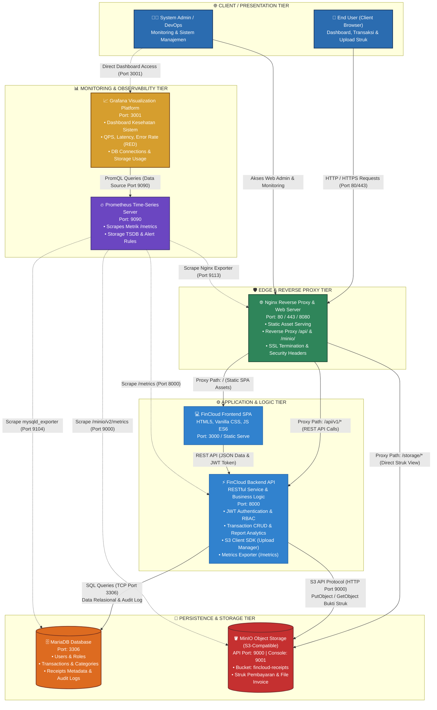

# Diagram & Spesifikasi Arsitektur Sistem FinCloud

Dokumen ini menjelaskan arsitektur sistem **FinCloud (Cloud-Based Financial Management & Monitoring Platform)** yang dikembangkan oleh tim **Cloud9**. Arsitektur ini mengadopsi pola *layered cloud-native architecture* yang memisahkan antarmuka pengguna, reverse proxy, layanan backend, persistensi data relasional, penyimpanan berkas objek, dan sistem observabilitas.

---

## 1. Diagram Arsitektur (Mermaid)

---

## 2. Rincian Komponen Arsitektur

| Komponen | Layer / Tier | Port Standar | Peran & Tanggung Jawab Utama |
|---|---|---|---|
| **Frontend (SPA)** | Client / Web App | `3000` | Antarmuka pengguna berbasis Single Page Application (HTML5, Vanilla CSS, JS ES6). Mengelola routing sisi klien (`#/dashboard`, `#/transactions`, `#/reports`), state management, visualisasi grafik canvas, dan interaksi formulir. |
| **Nginx** | Edge / Ingress Reverse Proxy | `80` / `443` / `8080` | Pintu gerbang lalu lintas masuk (*single point of entry*), menyajikan berkas statis frontend, melakukan *reverse proxy* ke API backend (`/api/`), routing ke MinIO (`/storage/`), terminasi SSL/TLS, serta menerapkan *security headers* dan *rate limiting*. |
| **Backend API** | Application Logic | `8000` | Core service RESTful API. Memproses autentikasi JWT & Role-Based Access Control (RBAC), kalkulasi agregasi finansial, validasi input, transaksi basis data, komunikasi S3 SDK dengan MinIO, dan mengekspos endpoint metrik `/metrics`. |
| **MariaDB** | Relational Database | `3306` | Basis data relasional ACID untuk menyimpan entitas terstruktur: `roles`, `users`, `categories`, `transactions`, `receipts` (metadata berkas), dan `audit_logs`. |
| **MinIO** | Object Storage (S3-Compatible) | `9000` (API) `9001` (Console) | Penyimpanan objek terdistribusi berkinerja tinggi untuk berkas biner non-relasional, seperti gambar struk bukti pembayaran (*receipts*), faktur, atau dokumen PDF transaksi dalam bucket `fincloud-receipts`. |
| **Prometheus** | Monitoring & Alerting | `9090` | *Time-series metrics engine* yang secara berkala melakukan *pull/scraping* metrik operasional dari endpoint `/metrics` Backend, Nginx exporter, MariaDB exporter (`mysqld_exporter`), dan MinIO metrics endpoint. Menyediakan *PromQL engine* dan evaluasi *alerting rules*. |
| **Grafana** | Visualisasi & Observabilitas | `3001` | Antarmuka visual analitik metrik real-time. Menghubungkan Prometheus sebagai data source untuk menampilkan dashboard kesehatan server (*RED metrics*: Rate, Errors, Duration), pemakaian memori/CPU, throughput transaksi, dan status koneksi storage. |

---

## 3. Alur Komunikasi & Interaksi Sistem (Traffic Flow)

### A. Alur Transaksi & Upload Bukti Pembayaran (Write Path)
1. **Pengguna** membuka halaman Transaksi pada browser dan mengunggah struk bukti pembayaran.
2. Request `multipart/form-data` dikirim melalui **Nginx** via rute `/api/v1/transactions`.
3. **Backend API** memverifikasi token JWT pengguna dan memproses payload.
4. Berkas gambar struk dikirim oleh backend ke **MinIO** menggunakan S3 API `PutObject` ke dalam bucket `fincloud-receipts`. MinIO mengembalikan *Object Key / URL*.
5. Metadata transaksi beserta *Object Key* struk disimpan ke dalam tabel `transactions` dan `receipts` pada **MariaDB**.
6. Response `201 Created` dikembalikan ke frontend dan antarmuka memperbarui daftar transaksi secara reaktif.

### B. Alur Pembacaan Laporan & Dashboard (Read Path)
1. Pengguna mengakses `#/dashboard` atau `#/reports`.
2. Frontend meminta agregasi data melalui endpoint `/api/v1/reports/summary`.
3. **Backend API** mengeksekusi kueri agregasi SQL (`SUM`, `COUNT`, `GROUP BY`) ke **MariaDB**.
4. Data JSON dikembalikan dan dirender oleh frontend ke dalam grafik Canvas (*Bar Chart* dan *Donut Chart*).

### C. Alur Monitoring & Observabilitas (Metrics Path)
1. Setiap interval (misalnya per 15 detik), **Prometheus** melakukan *HTTP GET* scraping ke target:
   - Backend API (`http://backend:8000/metrics`)
   - MariaDB Exporter (`http://mariadb-exporter:9104/metrics`)
   - Nginx Exporter (`http://nginx-exporter:9113/metrics`)
   - MinIO Cluster Metrics (`http://minio:9000/minio/v2/metrics/cluster`)
2. Metrik disimpan ke dalam basis data *Time-Series (TSDB)* Prometheus.
3. Administrator membuka **Grafana** di port `3001` untuk memantau performa sistem secara visual melalui kueri *PromQL*.
